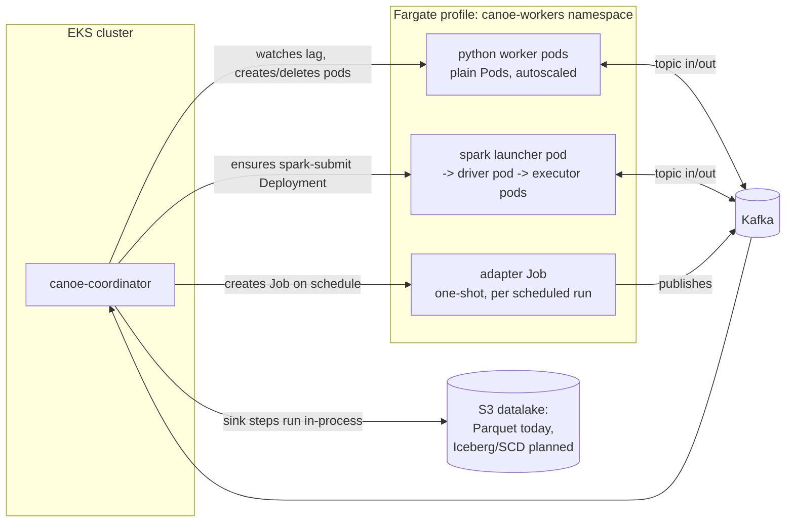

# canoe

A Kafka-and-S3 batch/streaming processing platform. Pipelines run as a set
of **chains**: sequences of **steps**, each named and wired to the next by
name, ending at a datalake **sink**. A step's transform is either a Python
function or an Apache Spark (SQL or DataFrame) job; each one independently
chooses `mode = "batch"` (S3 + signal transport, a one-shot K8s Job that
drains whatever's new and exits — see "Execution modes") or
`mode = "streaming"` (Kafka-topic transport, a genuinely continuous
process). The **coordinator** owns routing between steps and scales the
worker capacity that runs them. **Adapters** are how data gets into a
chain in the first place: scheduled jobs that pull from a source system
and publish to a topic.

```
orders.raw --[python: validate, batch]--> s3://canoe-lake/orders/v1/validate/ --[spark_sql: enrich, batch]--> s3://canoe-lake/orders/v1/enrich/ --[sink: parquet]--> s3://canoe-lake/dataset_id=orders/run_id=<ulid>/
```

The coordinator only ever reads the YAML form of this (`PipelineConfig` in
`crates/canoe-config`) — see `examples/orders-pipeline.yaml`. You can write
that YAML by hand, or author pipelines in **canoe's DSL** (`crates/canoe-dsl`,
compiled to YAML by the `canoe-dslc` CLI) instead of writing Python/Spark
code directly for common transforms:

```hcl
storage {
  base_path = "s3://canoe-lake"
  version   = "v1"
}

pipeline "orders" {
  source = "orders.raw"
}

step "validate" {
  engine = "python"
  input  = "orders.raw"

  filter { predicate = "amount > 0" }
  rename {
    from = "cust_id"
    to   = "customer_id"
  }
}

sink "land" {
  input      = "validate"
  format     = "parquet"
  base_path  = "s3://canoe-lake"
  dataset_id = "orders"
}
```

`rename`, `filter`, and friends compile to generated Python or Spark SQL —
see "The DSL" below for the full op vocabulary and how branching pipelines
read as a flowchart in text. `examples/orders.canoe.hcl` is the same
"orders" pipeline as `examples/orders-pipeline.yaml`, but declarative and
with a region-based branch; compile it with:

```
cargo run -p canoe-dslc -- examples/orders.canoe.hcl -o examples/orders-pipeline.generated.yaml
```

## Architecture

The coordinator runs as a singleton in an EKS cluster and does not process
message payloads itself — it reconciles *infrastructure* against the
pipeline config:

- **Python steps** choose `mode = "batch"` (the default — see "Execution
  modes: batch vs. streaming" below) or `mode = "streaming"`. Batch mode
  fires a one-shot Kubernetes `Job` per execution
  (`crates/canoe-k8s/src/step_job.rs`), scheduled onto an EKS **Fargate
  profile** (`deploy/k8s/fargate-profile.md`): the coordinator's reconcile
  loop checks S3 backlog on `reconcile_interval_secs`, fires a Job when
  there's real work and none already in flight, and polls it to
  completion — Job success is a native "done" signal, with no persistent
  pod ever running idle. Streaming mode instead runs as a set of plain,
  persistent Kubernetes `Pod`s (deliberately *not* a Deployment — see
  "Step pods, not Deployments" below), continuously consuming a Kafka
  topic. Either way, every step's pods run the same generic worker image
  (`workers/python-worker`); the actual step function is resolved at
  startup from `CANOE_CODE_SOURCE`/`CANOE_ENTRYPOINT` (inline source, an
  S3 object, or a git ref+path).
- **`uv` steps** predate (and are unaffected by) the batch/streaming mode
  split above — always a persistent `Pod`, same Fargate/autoscaling model
  streaming-mode Python steps use, just a different worker image
  (`workers/uv-step-worker`) running a different kind of process: the
  step's script is a full standalone `uv run` program with its own PEP
  723 dependency header, owning its entire consume/produce loop rather
  than a `def run(record)` called from inside a shared environment. See
  "Custom scripts in pipelines" under **The DSL**.
- **Spark steps** (`spark_sql`/`spark_dataframe`) choose a mode too,
  defaulting to `mode = "streaming"` (preserving every pipeline written
  before the mode split existed) — a `spark-submit --master k8s://...
  --deploy-mode cluster` process the coordinator keeps running forever in
  a supervisor Deployment; cluster mode spark-submit creates the actual
  driver pod, which requests its own executor pods, consuming/producing
  Kafka topics via `spark.readStream`/`writeStream`. `mode = "batch"`
  instead wraps the identical `spark-submit` invocation in a one-shot
  Job (`SparkLauncher::ensure_sql_batch_step`/`ensure_dataframe_batch_step`,
  same `step_job.rs` Job machinery Python batch mode uses) — `CANOE_TRANSPORT=batch`
  tells `workers/spark-runner/canoe_spark_runner.py` to read every
  unprocessed S3 `run_id=` since its own checkpoint (`spark.read.parquet`
  across all of them, the same full-backlog-draining guarantee Python's
  batch mode gives) instead of subscribing to a Kafka topic, and to write
  through `canoe_output_writer.py` (mirroring the Python worker's own
  `run_id=`/`schema.avsc`/`latest.json` convention) instead of producing
  to a topic. Both modes land on the same Fargate profile as Python
  workers; Spark's own dynamic allocation handles executor scaling
  either way, not canoe's autoscaler — see `crates/canoe-spark`.
- **Sinks** run inside the coordinator process itself (no separate pods):
  a sink step subscribes to its input topic, buffers rows, and flushes to
  the datalake on batch size or a flush interval. Only a Parquet sink is
  implemented today; `IcebergSink` and `ScdSink` are stubs behind the
  same `Sink` trait in `crates/canoe-sink` so they can be filled in
  without touching the coordinator or config schema. Every flush is its
  own immutable, lexically-sortable **run**: rows land under
  `<base_path>/dataset_id=<dataset_id>/run_id=<run_id>/` (Hive-partitioned
  by `partition_by` within that run directory), and `dataset_id=<dataset_id>/`
  also gets a `schema.avsc` (Avro schema for the batch just written) and a
  `latest.json` pointing at the most recent run — see "Datalake writes"
  below. A sink with a `checkpoint` block additionally gets a
  deduplicated, compacted `checkpoint=<ulid>/` view folded from that run
  history after every flush — see "Checkpoints" below. A sink with an
  `scd` block instead gets a versioned `scd=<ulid>/` Type-2
  slowly-changing-dimension rollup — see "Slowly changing dimensions"
  below; a sink can have both at once.
- **Triggered chains** don't start at all until named — no Deployment
  created, no Spark launcher submitted, no sink consumer running. The
  coordinator holds them as pending activations and starts them the first
  time a matching signal arrives on its internal signals topic; a sink
  elsewhere fires that signal after a successful flush. See "Signals"
  under **The DSL** and `crates/canoe-coordinator/src/signals.rs`.
- **Adapters** are how data enters a chain: a standalone `uv run` Python
  script, scheduled by the coordinator (interval or cron, an
  Airflow-scheduler-style loop per adapter — not K8s CronJob) and run as
  a one-shot K8s Job that publishes to a topic. See "Adapters" under
  **The DSL** and `crates/canoe-coordinator/src/scheduler.rs`.
- **Durability and archival**: a top-level `topics { ... }` block sets
  Kafka retention (applied via the admin API at startup) and/or a
  periodic Parquet dump of every internal chain-wiring topic to S3, via
  its own consumer group entirely separate from the pipeline it's
  watching. See "Durability and archival" under **The DSL** and
  `crates/canoe-coordinator/src/{retention,archiver}.rs`.
- **Dynamic splitting** (`dynamic_route`) is the only construct in canoe
  where the coordinator provisions new step pod sets *at run time*, not
  just at startup from the compiled config: it watches a topic, and the
  first time it sees a new value of some field it provisions a dedicated
  topic + pod set for that value alone (the same pod-based step machinery
  as any other step — scale-to-zero and the crash-loop circuit breaker
  both apply to it too), capped to avoid runaway creation on a
  high-cardinality field. See "Dynamic splitting" under **The DSL** and
  `crates/canoe-coordinator/src/dynamic_router.rs`.
- **Metrics**: every task pushes its own metrics to the coordinator
  (`POST /metrics/report`) rather than being scraped directly — a
  built-in Pushgateway, since an adapter's Job may not live long enough
  for Prometheus's next scrape and a step's pod set scales on its own
  schedule. Prometheus scrapes the coordinator's `GET /metrics` as its
  only static target. See "Metrics" under **The DSL** and
  `crates/canoe-coordinator/src/metrics.rs`.
- **Log collection**: every Python/`uv` step pod and adapter Job ships
  its own logs directly to a global S3 location (`--log-base-path`),
  organized `<pipeline|adapter>/<task>/<year>/<month>/<run-date>_<ulid>.log`.
  Unlike metrics, this goes task-to-S3 directly, not through the
  coordinator. See "Log collection" under **The DSL**.



## The DSL

`crates/canoe-dsl` compiles a small HCL dialect into `PipelineConfig` YAML.
It's an authoring-time compiler only — the coordinator never parses the
DSL, only its compiled YAML output — so nothing about the coordinator, K8s
reconciliation, or autoscaling changes based on whether a pipeline was
authored as YAML or DSL.

Every block — `pipeline`, `step`, `route`, `dynamic_route`, `merge`,
`sink`, `task`, `adapter` — is a discrete, root-level declaration, not
nested inside another one: Terraform-resource style, each references the
others **by name** (`input = "validate"`), not by Kafka topic. A
`pipeline` block itself is just an entry point and activation policy
(`source_topic`, and an optional `schedule`) — it doesn't list its own
steps anywhere; `canoe-dsl` discovers which `step`/`route`/`dynamic_route`/
`sink` blocks belong to a given pipeline by tracing every `input = "..."`
reference reachable from that pipeline's `source_topic`, the same way
`terraform apply` derives its dependency graph from resource references
rather than an explicit list. Every step/route/dynamic_route/merge/
sink/task/pipeline/adapter name must be unique across the whole file (no
per-pipeline namespacing — there's no pipeline prefix to disambiguate
with, since nothing is nested), and a block that's declared but never
reachable from any pipeline's `source_topic` is a compile error, not
silently dropped. The compiler still assigns an internal topic to every
step's output, so authors never wire topic strings by hand — only a
pipeline's `source_topic` and a sink's `base_path` are real, external
names.

```hcl
pipeline "orders" {
  source_topic = "orders.raw"
}

step "validate" {
  engine = "python"
  input  = "orders.raw"
  filter { predicate = "amount > 0" }
}

sink "land" {
  input      = "validate"
  format     = "parquet"
  base_path  = "s3://canoe-lake"
  dataset_id = "orders"
}
```

`examples/orders.canoe.hcl` is the fullest worked example of this shape;
`crates/canoe-dsl/tests/orders_pipeline.rs` is the reference for what it
compiles to.

- **Declarative ops**, applied in the order written inside a `step`
  block: `filter { predicate = ... }`, `rename { from = ..., to = ... }`,
  `drop { fields = [...] }`, `select { fields = [...] }`,
  `cast { field = ..., to = ... }`, `with_field { name = ..., expression = ... }`,
  `map_values { field = ..., to = ..., mapping { ... } }` (below).
  These compile to generated Python (`engine = "python"`) or a chained-CTE
  Spark SQL query (`engine = "spark_sql"`) — see `crates/canoe-dsl/src/codegen.rs`.
  `python { code = <<EOT ... EOT }` / `spark_sql { sql = ... }` /
  `spark_dataframe { code = ... }` are escape hatches for anything the
  declarative vocabulary can't express yet; each must be a step's only
  block. Every one of these (and an adapter's `script`, below) also
  accepts `file = "path.py"` instead of `code`/`sql` — a path resolved
  relative to the `.hcl` file itself at compile time (`canoe-dslc` reads
  it and embeds the contents as `CodeSource::Inline`, so there's no
  runtime file lookup; see `RawCode::resolve` in `crates/canoe-dsl/src/ast.rs`).
  Useful once a script is long enough that it's more comfortable to edit
  as a real `.py` file with syntax highlighting than as a heredoc.
- **`map_values`** looks a field up in a JSON object (`{"cc": "credit_card", ...}`)
  and writes the result to `to` (defaults to `field` itself, an in-place
  replace); values missing from the mapping pass through unchanged
  unless `default` is set. The mapping itself is a `mapping { ... }`
  block with three source forms — `code = "..."` (inline JSON text),
  `file = "region_map.json"` (a local file, same compile-time resolution
  as the `file = ...` escape hatches above), or `bucket = "..."` +
  `key = "..."` (S3, resolved at *run time* by the worker pod instead —
  a compiling machine may have neither network access nor the right IAM
  role to fetch it, and a mapping may be updated independently of the
  pipeline that reads it). `engine = "spark_sql"` only accepts the
  compile-time-resolvable forms (`code`/`file`; it compiles to a `CASE
  WHEN` CTE, which needs literal values) — an S3 mapping there is a
  compile error pointing at `engine = "python"` instead. See
  `examples/orders.canoe.hcl`'s `validate` step
  (`examples/mappings/payment_method.json`) and
  `crates/canoe-dsl/tests/map_values.rs`.
- **Branching** reads as a flowchart in text: a `route` block sends each
  record down exactly one of several named `branch`es (first matching
  `when` predicate wins) plus an optional `default`, and downstream steps
  read from a branch with `input = "<route_name>.<branch_name>"`. Under
  the hood each branch is just its own independent consumer group
  filtering the route's input topic — no special runtime "router" exists.
  A `merge` block fans multiple upstream names back into one shared
  topic (pure topic aliasing, no pod runs for it); downstream steps then
  read `input = "<merge_name>"` like any other name.
- **Expressions** (`filter.predicate`, `with_field.expression`,
  `branch.when`) are SQL-flavored: bare field names, `=`/`<>`/`!=`, `AND`/
  `OR`/`NOT`, single-quoted strings. Spark SQL steps use them verbatim;
  Python steps get a small lexer-level transpile (`=` → `==`, `<>` → `!=`,
  keywords lowercased) — see `crates/canoe-dsl/src/expr.rs`.
- A DSL pipeline with branches compiles to **multiple `ChainConfig`
  entries**, one per simple path from `source_topic` to a sink — routing
  and merging are expressed purely through shared Kafka topic names, and
  `canoe-config`'s existing chain validation only understands strict
  linear sequences. A step downstream of a merge is duplicated across
  each converging chain; starting its pod set is idempotent (topping up
  to `min_replicas` is a no-op once already there), so this is harmless
  but means chain count grows with branch count — fine
  for hand-authored pipelines, not meant to scale to machine-generated
  DAGs with hundreds of branches. See the module docs in
  `crates/canoe-dsl/src/compiler.rs`.

### Dynamic splitting

`route` needs every branch's predicate written down at DSL-compile time.
`dynamic_route` is for the opposite case — you want to split by a field's
value, but don't know the value set up front (or it changes over time) —
an Airflow-`.expand()`-style dynamic fan-out, in HCL:

```hcl
dynamic_route "split_by_region" {
  input        = "validate"
  field        = "region"
  max_branches = 50            # required-in-spirit; defaults to 1024

  task {                       # applied to every discovered value
    engine = "spark_sql"
    with_field { name = "region_tag", expression = "region" }
  }

  overflow {                   # provisioned once, up front — catches
    engine = "python"          # anything past max_branches, or a
    with_field {                # missing/null field
      name       = "region_tag"
      expression = "'unclassified'"
    }
  }
}
```

Unlike `route` (fully expanded into N filter-only steps at DSL-compile
time — see above), a `dynamic_route` compiles to exactly **one**
`StepConfig::DynamicRoute` — a template, not N branches — and the
coordinator (`crates/canoe-coordinator/src/dynamic_router.rs`) discovers
branches at *run time*: it watches `input`, and the first time it sees a
new value of `field` it provisions a dedicated Kafka topic and pod set
(running `task`) for that value alone, through the exact same
`activation::start_python_step`/`start_spark_sql_step`/etc. machinery a
regular step uses — a real, independently scaling worker instance per
discovered value (with scale-to-zero and the crash-loop circuit breaker
both applying to it too), the "mapped task instance" part of the
analogy. Every task (and `overflow`) writes to the same
implicit merged topic; there's no way to `merge { inputs = [...] }`
branches whose names aren't known statically, so a dynamic_route merges
its own output. Downstream reads it by the dynamic_route's own name —
`input = "split_by_region"` — exactly like reading from a `merge`.

`max_branches` is required in spirit, not optional in the type system
(defaults to 1024 if you don't set it): an unbounded version of this
risks runaway K8s object creation on a high-cardinality or adversarial
field, the same reason Airflow's `.expand()` has `max_map_length`. Once
the cap is hit, a genuinely new value routes to `overflow` if configured,
or is dropped with a logged warning if not — same fallback for a record
whose `field` is missing or `null`. `examples/orders-dynamic.canoe.hcl`
is the dynamic-splitting twin of `orders.canoe.hcl`'s static
`split_by_region` `route`, and `crates/canoe-dsl/tests/dynamic_route.rs`
+ `crates/canoe-coordinator/src/dynamic_router.rs`'s own unit tests are
the reference for the compiled shape and runtime behavior.

Use `route` when you know the branch values ahead of time — it compiles
to less runtime machinery, and each branch can have genuinely different
logic per value rather than one template applied uniformly. Reach for
`dynamic_route` only when you don't know the values, since it's a bigger
mechanism: an extra consumer group doing the discovery/routing itself,
one pod set provisioned per distinct value it's ever seen (not
"currently seeing" — see Status below), and a single task template
shared across every value rather than bespoke per-branch logic.

`crates/canoe-dsl/tests/orders_pipeline.rs` compiles `examples/orders.canoe.hcl`
end to end and re-validates the output through `canoe_config::PipelineConfig`'s
own loader — a good reference for what compiled output looks like.

### Custom scripts in pipelines

A `python { code = ... }` step's function runs *inside* `workers/python-worker`'s
shared, long-lived process — called once per message, limited to whatever
third-party packages that one image happens to carry. `engine = "uv"` is
a second, different kind of step for when one genuinely needs a
dependency that image doesn't (and installing it there for a single step
isn't the right tradeoff): its body is a full standalone `uv run`
script — the same PEP 723 "own header declares its own dependencies"
convention an adapter's script uses, inline or from a file via the same
`code`/`file` choice every other DSL escape hatch offers:

```hcl
step "geocode" {
  engine = "uv"
  input  = "validate"

  script {
    file = "steps/geocode_enrich.py"   # or: script { code = <<-PY ... PY }
  }
}
```

The difference from every other engine matters: a `uv` step's script
*is* the whole program, not a function plugged into one. It owns its
entire Kafka consume/produce loop itself, reading `CANOE_INPUT_TOPIC`/
`CANOE_OUTPUT_TOPIC`/`CANOE_KAFKA_BOOTSTRAP` — the same env-var
convention an adapter's script reads, just running continuously in a K8s
Deployment (`workers/uv-step-worker`, a separate image from
`python-worker`) rather than a one-shot Job, since a step processes an
ongoing stream, not a scheduled pull. `workers/uv-step-worker/run.py`
resolves the script per `CANOE_CODE_SOURCE` and runs it as a `uv run`
child process, forwarding its stdout/stderr both to the container's own
stdout and (if configured) to S3 — see "Log collection" below — and
forwarding SIGTERM/SIGINT straight through to the child so shutdown still
behaves the same as it did when the script ran as PID 1 directly (an
earlier version used `os.execvp` for that property for free; reading the
script's own output to ship it needs a real child process instead).
Lag-driven autoscaling (including scale-to-zero and the crash-loop
circuit breaker) works identically to a regular Python step's pod set
(`Autoscaler::reconcile_uv_step`, same scaling logic, different
pod-naming/image plumbing underneath — `crates/canoe-k8s/src/pod_manager.rs`'s
`create_uv_pod`).

`examples/orders-uv-step.canoe.hcl` has two `uv` steps for contrast: one
reading its script from `examples/steps/geocode_enrich.py` via `file`,
one with a shorter script inlined via `code`.
`crates/canoe-dsl/tests/uv_step.rs` is the reference for the compiled
shape (no `entrypoint` field, unlike a `PythonStep` — the whole script
is the entrypoint).

**env vars**: a `python`/`uv` step can carry an `env { ... }` block —
plain config for the script to read via `os.environ`, declared where
every other knob for that step already lives instead of hardcoded inside
the script itself. `examples/orders-uv-step.canoe.hcl`'s `geocode` step
uses this for its API endpoint and timeout:

```hcl
step "geocode" {
  engine = "uv"
  input  = "validate"
  script { file = "steps/geocode_enrich.py" }

  env {
    GEOCODE_API_URL      = "https://geocode.example.com/v1/search"
    GEOCODE_TIMEOUT_SECS = 10
  }
}
```

```python
# steps/geocode_enrich.py
GEOCODE_API_URL = os.environ.get("GEOCODE_API_URL", "https://geocode.example.com/v1/search")
```

Every attribute in the block becomes one env var on the step's pod,
alongside canoe's own `CANOE_*` ones (`crates/canoe-k8s/src/pod_manager.rs`'s
`create_python_pod`/`create_uv_pod` append them last). Values are
coerced to strings the same way any other DSL attribute is, so
`RETRIES = 3` and `RETRIES = "3"` compile to the same thing — K8s env
vars are always strings regardless. `canoe-dsl` rejects two things at
compile time rather than letting either fail silently or corrupt the
runtime: a key using canoe's own reserved `CANOE_` prefix (case
insensitive), and an `env` block on any engine other than `python`/`uv`
(`spark_sql`/`spark_dataframe`, and `dynamic_route` tasks/overflow —
see "Status / what's stubbed" for the latter). There's no equivalent for
adapters yet either — an adapter's script only has whatever the Job's pod
spec already sets (`CANOE_ADAPTER_NAME`, `CANOE_OUTPUT_TOPIC`, etc.) plus
anything a hand-edited YAML config's pod spec adds.

**Batching**: a Python step normally calls its function once per Kafka
message — `def run(record: dict) -> ...`. A `batch { size = ...,
flush_interval_secs = ... }` block switches `workers/python-worker` to
buffer up to `size` records (or `flush_interval_secs`, whichever comes
first) and call the function once per batch instead, with the whole list:

```hcl
step "enrich_with_fx_rate" {
  engine = "python"
  input  = "orders.raw"

  python {
    code = <<-PY
      def run(records: list[dict]) -> list[dict]:
          rate = fetch_fx_rate(records[0]["currency"])  # one lookup for the whole batch
          for record in records:
              record["amount_usd"] = record["amount"] * rate
          return records
    PY
  }

  batch {
    size                 = 500
    flush_interval_secs  = 5   # optional, defaults to 5
  }
}
```

The point of batching is amortizing a genuinely per-call cost (a network
round trip, a vectorized computation that's wasteful one row at a time)
across many records instead of paying it on every single message — see
`examples/orders-batch.canoe.hcl` for a fuller worked example (a
currency-conversion lookup done once per batch).

**Only valid on a `python { code = ... }` escape-hatch step** — canoe-dsl
rejects `batch` on declarative ops (`filter`/`rename`/... always compile
to a fixed `def run(record): ...` contract, one record at a time, so
there's no batch-shaped function for it to call) and on any engine other
than `python` (a `uv` step already owns its entire consume loop, so
batching is the script's own concern there; see "Status / what's
stubbed" for `spark_sql`/`spark_dataframe`/`dynamic_route`). Two things a
batch function's contract loses versus the per-record one:
- **No per-record error isolation.** A raised exception drops the
  *whole* batch (the consumer still commits past it, same "log and move
  on" choice the per-record path already makes for one bad record — see
  `canoe_worker/main.py`'s `_flush_batch`), not just whichever record in
  it actually caused the failure.
- **No Kafka message key on produced output.** A batch collapses many
  messages' worth of keys into one function call, so there's no single
  natural key to attach — every record a batch function returns is
  produced with `key=None`, unlike the per-record path's `key=msg.key()`.

`crates/canoe-dsl/tests/batch.rs` covers the compile-time rules;
`workers/python-worker/tests/test_batch.py` covers `_flush_batch`/
`_run_batch_loop`'s buffering, error, and commit behavior directly.

### Signals

A `sink` can name a `signal`, fired after every successful flush; a
*different* pipeline names the same signal in a `schedule` block to start
when that write happens — the cross-pipeline trigger this section exists
for:

```hcl
# examples/orders.canoe.hcl
sink "land" {
  input      = "enriched"
  format     = "parquet"
  base_path  = "s3://canoe-lake"
  dataset_id = "orders"
  signal     = "orders_landed"
}
```

```hcl
# examples/orders-rollup.canoe.hcl
pipeline "orders_rollup" {
  schedule {
    signal = "orders_landed"
  }
  source_topic = "orders.enriched"
  ...
}
```

Mechanically: every sink with a `signal` gets a Kafka producer, and every
pipeline with a `schedule.signal` compiles its `trigger` onto each of its
chains (`ChainConfig.trigger`, `TriggerConfig` in `crates/canoe-config`).
At startup the coordinator starts every *untriggered* chain immediately,
but a triggered chain's steps go into a pending-activations map instead —
literally nothing about it exists yet (`crates/canoe-coordinator/src/activation.rs`).
All sinks with a `signal` also get a producer to the coordinator's
internal signals topic (`_canoe.signals` by default); the coordinator runs
one more singleton loop consuming that topic
(`crates/canoe-coordinator/src/signals.rs`), and the first time a signal
arrives, every chain pending on it gets started — Deployments applied,
Spark launchers submitted, sink consumers spawned — exactly as if they'd
been declared without a `schedule` block from the start.

This is a one-way "cold start," not a re-run trigger: a signal only
activates each pending step once — there's no automatic "go dormant again
after processing settles" behavior distinct from what any other chain
already gets from `scaling { min_replicas = 0 }` (see "Scale to zero"
below), which applies uniformly whether a chain was triggered or started
immediately.

### Cross-pipeline lookups

A step's `input` names another node *within the same `.hcl` file*,
incrementally — new `run_id=` batches wake the step up and it self-heals
via checkpoint if it misses a signal. Joining against data owned by a
step in a **wholly separate `.hcl` file** (a different pipeline, possibly
a different deployment/bucket entirely) is a different problem: there's
no shared compiled graph to resolve a name against, and usually what you
actually want isn't "every new batch that pipeline ever writes" but
"whatever it currently has" — a dimension-table/snapshot join, not a
second stream. `lookup` blocks are for exactly this:

```hcl
step "join_customer_snapshot" {
  engine = "spark_sql"
  input  = "orders_validated"

  lookup "customers" {
    pipeline = "customer_pipeline"      # a pipeline{} block in a *different* .hcl file
    node     = "customer_snapshot"      # that pipeline's step/sink name
    # base_path/version default to this file's own storage {} block;
    # override either to reach a genuinely different deployment/bucket.
  }

  spark_sql {
    sql = "SELECT * FROM input LEFT JOIN customers ON input.customer_id = customers.id"
  }
}
```

A step may declare multiple `lookup` blocks — one per snapshot it needs.
Each is resolved at compile time to a plain path
(`<base_path>/<pipeline>/<version>/<node>`, `canoe-dsl`'s
`resolve_lookup`) via string formatting alone, **never** through the
same-file name→path graph `input` uses — the target isn't a node this
compiler invocation ever parses, so there's no existence check possible.
A typo'd `pipeline`/`node` compiles cleanly and only surfaces at run time,
as a missing/empty `latest.json` (see below). `dynamic_route` tasks
reject `lookup` blocks outright — that stays on the Kafka-topic
transport.

At run time a lookup is read via the target node's `latest.json` pointer
(written by every S3-writing node on every flush already — no
producer-side change needed) rather than tracked incrementally:
`canoe_worker/lookup.py`'s `fetch_lookup`/`LookupCache` fetch and briefly
cache each declared lookup's current rows, and a Python step's `run()`
gains an extra `lookups: dict[str, list[dict]]` argument whenever the
step declared at least one (`def run(record, lookups): ...`) — dispatch
is config-driven, not signature-inspected, same as `batch {}` elsewhere.
For `spark_sql`/`spark_dataframe` steps, `canoe_spark_runner.py` re-reads
every lookup fresh on each micro-batch (via `foreachBatch`, not a single
query built once — a static Spark DataFrame read up front would pin the
join to whatever was current at container startup forever); SQL mode
registers each lookup as a temp view under its own name, dataframe mode
passes them as a `lookups` dict to `transform(df, lookups=...)`. A `uv`
step gets the resolved paths as `CANOE_LOOKUP_<NAME>_PATH` env vars and
fetches/joins them itself, consistent with its "script owns everything"
contract.

### Column-level field encryption

`step`, `sink`, and `adapter` blocks accept one or more `encrypt` blocks,
naming which fields to encrypt at rest and under which key:

```hcl
sink "land" {
  input      = "flag_high_value_customers"
  format     = "parquet"
  base_path  = "s3://canoe-lake"
  dataset_id = "orders_enriched"

  encrypt {
    fields = ["ssn", "email"]
    key    = "pii_v1"
  }
}
```

This is **application-level field encryption** (AES-256-GCM over a single
JSON value), not Parquet's native columnar encryption — canoe is
polyglot across Rust (the coordinator/`canoe-sink`), Python
(`python-worker`), and PySpark, and Rust's own Parquet-encryption support
is too immature to trust for byte-compatible cross-engine interop.
Instead, an encrypted field becomes a **self-describing ciphertext
string**, the same convention HashiCorp Vault's transit engine uses
(`vault:v1:...`):

```
canoe:enc:v1:<key_name>:<base64(nonce(12 bytes) || ciphertext+tag)>
```

The field name is bound in as AAD (so a ciphertext can't be silently
swapped between two encrypted columns even under the same key), and the
plaintext is the JSON encoding of the original value — so decrypt
recovers the original type, not always a string. Being self-describing
(rather than recorded as `schema.avsc` metadata) is what lets it travel
correctly through *every* boundary this codebase has, with no extra
plumbing: Kafka-topic payloads (`spark_sql`/`spark_dataframe` steps'
primary I/O, adapters), `Checkpointer`/`ScdView` compaction (which pass
generic rows through without ever needing to know a field is
encrypted), and cross-file `lookup` reads (no shared compile-time
knowledge needed — the value announces itself).

**Keys** are static for now (a later migration can move to KMS): a key
named `"pii_v1"` resolves from `CANOE_ENCRYPT_KEY_PII_V1` — a base64-
encoded 32-byte AES-256 key — read from whichever process is
encrypting/decrypting (the coordinator's own env for a sink's write
path; each pod's own env for worker runtimes). The coordinator forwards
every `CANOE_ENCRYPT_KEY_*` var it finds in its own environment onto
every pod/Job it creates (`crates/canoe-k8s/src/encrypt_env.rs` — a
prefix-match passthrough, since key names are user-declared, unlike the
fixed S3-credential allowlist in `s3_env.rs`).

**Transparency differs by runtime**:
- `python`/`spark_sql`/`spark_dataframe` steps: fully transparent. Every
  read path (`canoe_worker.main`'s S3+signal loop, `lookup.fetch_lookup`,
  `canoe_spark_runner.py`'s input/lookup DataFrames) decrypts any
  `canoe:enc:v1:`-prefixed value it finds *before* the step's own
  `run()`/SQL ever sees it — a step doesn't need to know ahead of time
  which fields are encrypted, or even that a field is encrypted at all.
  A step's own `encrypt` block then applies to *its own* declared output
  fields on write.
- Sinks are transparent for their own declared `encrypt` fields (applied
  by `run_writer.rs`/`output_writer.py` before writing), but — a
  deliberate refinement worth calling out — **the coordinator itself
  never decrypts**. A field some upstream step already encrypted just
  passes through a sink (and `Checkpointer`/`ScdView` compaction) as
  opaque ciphertext, unchanged. This is safer, not a compromise: it means
  the coordinator process, which only ever orchestrates and writes,
  never needs decrypt-key access at all — only the workers whose step
  code actually needs plaintext do.
- `adapter`/`uv` steps are **not** automatic — these runtimes own their
  entire loop (the same reason `env {}` exists for user config rather
  than canoe injecting it). canoe only resolves the named key(s) into
  `CANOE_ENCRYPT_KEY_<NAME>`/`CANOE_ENCRYPT_FIELDS` env vars; the
  script author calls the same wire-format helper explicitly.

**Never encrypt a field also used as a `checkpoint.keys`/`scd.keys`/
`scd.track_fields` entry on the same sink** — AES-GCM's random nonce
means identical plaintexts encrypt to different ciphertext every time,
silently breaking dedup/change-detection equality on that field.
`canoe-dsl` rejects this combination at compile time.

### Secrets Manager integration

`step`, `adapter`, and `task` blocks accept a `secrets` attribute naming
AWS Secrets Manager entries the pod/Job should have mounted as files:

```hcl
adapter "stripe_charges" {
  topic   = "stripe.charges.raw"
  secrets = ["stripe_api_key"]
  ...
}
```

Unlike `encrypt`, this needs no crypto helper on the script's part — it's
just a file mount. canoe provisions a `SecretProviderClass` (via the
[Secrets Store CSI
Driver](https://secrets-store-csi-driver.sigs.k8s.io/) + AWS provider,
ASCP — assumed already installed on the target cluster, same as canoe
assumes a Fargate profile or Spark-on-K8s already exist rather than
installing them itself) naming each declared secret, attaches the
matching CSI volume to the pod/Job, and sets `CANOE_SECRETS_PATH`
(`/mnt/secrets-store`) so a script never needs to hardcode the mount
path — each secret shows up as its own file there, named after it:

```python
from pathlib import Path
import os

api_key = (Path(os.environ["CANOE_SECRETS_PATH"]) / "stripe_api_key").read_text().strip()
```

Every `python`/`uv` step pod and adapter/task Job that declares `secrets`
runs under a dedicated `canoe-secrets` ServiceAccount (`deploy/k8s/rbac.yaml`)
rather than its usual one — a pod with no `secrets` declared is
unaffected. Its IAM role (bound via an IRSA annotation, filled in
out-of-band) needs `secretsmanager:GetSecretValue` granted on whichever
secret ARNs your pipelines actually reference — canoe has no way to
provision that permission itself, and no way to check at compile time
that a declared secret actually exists.

A `spark_sql`/`spark_dataframe` step's driver pod gets the same CSI
mount, wired in via spark-submit `--conf spark.kubernetes.driver.volumes.csi.*`
flags rather than a pod spec canoe authors directly (`canoe-spark`'s
`SparkLauncher` never does — spark-submit itself creates the driver pod
in cluster mode). It deliberately keeps using `canoe-spark`'s own
ServiceAccount rather than switching to `canoe-secrets`, since a Spark
driver already needs `canoe-spark`'s pod-management permissions to
create executors — grant `canoe-spark`'s IAM role Secrets Manager access
directly instead if a Spark step declares `secrets`.

`dynamic_route`/`KafkaPythonStep` and sinks don't support `secrets` — a
sink runs inside the coordinator process itself (Phase 1 moved sinks off
separate pods), so there's no pod to mount a CSI volume into; dynamic_route
is out of scope for now, consistent with `lookup`/`encrypt`.

### Column metadata at sink points

A `sink { ... }` block accepts a `metadata` attribute naming a YAML file,
adjacent to the `.hcl` file, of per-column metadata — labels,
descriptions, sensitivity/classification tags, or any other free-form
keys:

```hcl
sink "land_customers" {
  input      = "snapshot"
  format     = "parquet"
  base_path  = "s3://canoe-lake"
  dataset_id = "customers"
  metadata   = "customer-column-metadata.yaml"
}
```

```yaml
# customer-column-metadata.yaml
id:
  label: "Customer ID"
  description: "Unique identifier for the customer"
email:
  label: "Email Address"
  sensitivity: "restricted"
  classification: ["pii", "contact"]
```

Each column's value is an **open map** — `label`/`description`/
`sensitivity`/`classification` are the documented examples, not a fixed
schema, so any other key a file declares passes through untouched.
`canoe-dslc` reads and parses the YAML **at compile time** (same
precedent as `map_values`'s `mapping { file = ... }`), embedding the
result directly into the compiled config — the YAML file itself doesn't
need to be present wherever the coordinator actually runs.

The metadata is embedded as a `canoe.metadata` custom property per
matching field in every run's `schema.avsc`
(`crates/canoe-sink/src/avro.rs::arrow_schema_to_avsc`) — the existing
per-run schema file is already "persistent and accessible near the
written data," so no separate sidecar file is written for this, and any
downstream reader (a person, `canoe-tui`, an external catalog tool)
already just reads `schema.avsc` as plain JSON. `metadata` is
independent of `encrypt` — a field can be both encrypted and have
descriptive metadata; one doesn't gate the other. Scoped to sinks only,
not steps/adapters. canoe can't validate at compile time that a metadata
file's column names actually match the sink's output fields (row shape
isn't known until runtime) — an accepted limitation, same class as
`lookup`'s unchecked cross-file references.

### Execution modes: batch vs. streaming

Every `step` independently chooses `mode = "batch"` or `mode = "streaming"`
— orthogonal to `engine` (`python`/`spark_sql`/`spark_dataframe`; `uv`
predates this split and has no `mode` of its own, see "Step pods, not
Deployments" below), not implied by it:

```hcl
# mode = "batch" is already the default for engine = "python" — spelled
# out here anyway, for contrast with the streaming step below. S3+signal
# transport, one-shot Job per execution, draining backlog via
# CANOE_RUN_ONCE.
step "validate" {
  engine = "python"
  mode   = "batch"
  input  = "orders.modes.raw"

  filter {
    predicate = "amount > 0"
  }
}

# A regular `step` block declaring `mode = "streaming"` explicitly —
# Kafka-topic transport, a genuinely continuous `spark.readStream` query
# (KafkaSparkSqlStep), the exact same runtime `dynamic_route`'s internal
# per-discovered-value pods already use, now reachable on an ordinary
# step rather than only through dynamic_route's own machinery.
step "rollup_streaming" {
  engine = "spark_sql"
  mode   = "streaming"
  input  = "orders.modes.raw"

  spark_sql {
    sql = "SELECT region, sum(amount) AS total_amount FROM input GROUP BY region"
  }
}
```

(Full runnable pipeline: `examples/orders-execution-modes.canoe.hcl`.)

**`batch`** (the default for `python`, not for `spark_sql`/
`spark_dataframe` — see "Defaults preserve every pipeline..." below) is
S3 + signal transport: the step is a one-shot
K8s `Job` (`crates/canoe-k8s/src/step_job.rs`), fired by the
coordinator's reconcile loop only when `S3BacklogInspector` reports real
unprocessed backlog *and* no Job for this step is already in flight
(`activation::decide_batch_action` — a pure, unit-tested decision
function covering exactly those two rules). The Job drains every
unprocessed `run_id=` since its own checkpoint, writes its output, and
exits; `job_status` polling observes that exit as completion — a free,
native "done" signal, unlike a persistent pod, which never finishes. See
"Step pods, not Deployments" for what replaces the old always-on
pod-per-step model, and "`depends_on`/`depends_on_complete`" below for
how other steps/tasks can wait on that completion.

**`streaming`** is Kafka-topic transport — a genuinely continuous
process with no natural "done": a persistent `Pod` running
`workers/python-worker`'s Kafka consume/produce loop for `python`
(`KafkaPythonStep` — the same struct/runtime `dynamic_route`'s internal
per-discovered-value pods already use), or a long-running `spark-submit`
Deployment doing `spark.readStream`/`writeStream` for `spark_sql`/
`spark_dataframe` (`KafkaSparkSqlStep`/`KafkaSparkDataFrameStep`).

**Defaults preserve every pipeline written before `mode` existed**:
`python` defaults to `"batch"` (it was already S3+signal transport before
this attribute existed — Phase A of this split just gave the old
persistent-pod-that-loops-forever behavior a Job-based replacement and
made it opt-out-able); `spark_sql`/`spark_dataframe` default to
`"streaming"` (Spark had no batch option at all before this split, so its
*existing* behavior had to stay the default). `uv` has no `mode` at all —
declaring one is a compile-time error, since a `uv` step already owns its
entire consume/produce loop and there's nothing a mode choice would
change about it.

**Lookups/`encrypt` are batch-only**: both need the S3+signal transport
to have anything to read/write, so `canoe-dsl` rejects either on a
streaming-mode step. `output {}` (batching/partitioning config) is
likewise batch-only — a streaming step has no S3 output to configure.

**Spark job configuration**: a `spark_sql`/`spark_dataframe` step's
`spark { ... }` block covers the common knobs directly
(`image`/`executor_instances`/`executor_cores`/`executor_memory`/
`driver_memory`), plus an open `conf = { ... }` object for anything else
— passed straight through as `spark-submit --conf <key>=<value>`, keyed
by Spark's own dotted setting names:

```hcl
spark {
  executor_instances = 3
  conf = {
    "spark.sql.shuffle.partitions"      = "200"
    "spark.sql.files.maxPartitionBytes" = "134217728"
  }
}
```

Deliberately no canoe-invented aliases (no `partitions` shorthand for
`spark.sql.shuffle.partitions`) — `conf`'s keys are Spark's own
vocabulary verbatim, not a second one to keep in sync with Spark's own
docs as its config surface changes. An object literal, not a nested
block: HCL body-attribute identifiers can't contain dots, and Spark's
setting names always do. See `examples/orders-execution-modes.canoe.hcl`'s
`spark_batch_enrich` step for a full runnable example.

### Spark event logging

A batch-mode Spark Job's driver pod exits on completion — its live Spark
UI disappears with it, so there's no way to inspect a completed run's
stages/tasks/SQL plans afterward. **canoe only configures** Spark's
native event logging (`spark.eventLog.enabled`/`spark.eventLog.dir`) on
every driver, both batch and streaming — running or pointing an actual
[Spark History Server](https://spark.apache.org/docs/latest/monitoring.html#viewing-after-the-fact)
at the resulting path is entirely up to you; canoe does not deploy or
manage one itself.

The default lives in a **coordinator-level global config file**, not the
DSL — this is operator/deployment-scoped configuration (like
`--namespace`/`--worker-image` already are), consistent across every
pipeline one coordinator runs, not something a pipeline author should
declare per `.hcl` file:

```yaml
# examples/global-config.yaml
spark:
  event_log:
    enabled: true
    base_path: s3a://canoe-lake/_spark-events
```

```
canoe-coordinator --config pipeline.yaml --global-config examples/global-config.yaml ...
```

`--global-config` (`CANOE_GLOBAL_CONFIG`) is entirely optional — omit it
and event logging is off everywhere by default. A step can override the
global default for itself via the *existing* `spark { ... }` block's
`event_log { ... }` sub-block — most steps declare nothing here at all
and just inherit the global setting:

```hcl
spark {
  event_log {
    enabled = false   # opt this one step out of an enabled global default
  }
}
```

The merge (global default + step override → final `spark.eventLog.dir`)
happens at Spark-launch time in the coordinator, not at DSL-compile
time — a step's own field wins when it sets one, otherwise it falls back
to the global value; event logging is off if the effective `enabled`
never resolves to `true`. Use an `s3a://` base path, not canoe's usual
`s3://` convention elsewhere in this repo — Spark's bundled Hadoop S3
connector registers the `s3a` scheme, not `s3`.

### `depends_on` / `depends_on_complete`

A `step` or `task` can declare an ordering-only dependency on another
name — no data is consumed, just a "don't start until" gate:

```hcl
# depends_on / depends_on_complete: this step's own batch Job won't fire
# until "spark_batch_enrich" has both been applied (depends_on — reuses
# the coordinator's existing ctx.activated) and actually *completed* at
# least once (depends_on_complete — reuses ctx.completed, populated when
# a batch-mode step's Job succeeds).
step "notify_after_first_batch" {
  engine = "python"
  input  = "validate"
  depends_on          = ["spark_batch_enrich"]
  depends_on_complete = ["spark_batch_enrich"]

  python {
    code = <<-PY
      def run(record: dict) -> dict:
          record["notified_after_batch_enrich"] = True
          return record
    PY
  }
}
```

(Same file, `examples/orders-execution-modes.canoe.hcl`.)

**`depends_on`** is the *applied* gate `task.depends_on` has always had
(a step/dynamic_route/pipeline/task name has been applied —
`Ctx.activated`, set the moment a Deployment/Job/launcher was created,
never once it's actually finished — see `crates/canoe-coordinator/src/tasks.rs`'s
module docs), now available on `step` too, not only `task`.

**`depends_on_complete`** is a real *completion* gate — a name is
satisfied only once its own Job has actually succeeded (`Ctx.completed`,
populated by a batch-mode step's reconcile loop, or by a task on its own
success — `crates/canoe-coordinator/src/activation.rs::mark_completed`).
Only a batch-mode step or a `task` ever has a "done" to report; a
streaming-mode step or `dynamic_route` never does, so `canoe-dsl` rejects
a `depends_on_complete` entry naming one at compile time, with a message
naming the offending step.

Both attributes are only meaningful on a **batch-mode** step — declaring
either on a streaming-mode step or `uv` is also a compile-time error
(nothing would ever check them: there's no Job-firing reconcile loop for
either to gate).

### Step pods, not Deployments

These are the two runtime shapes "Execution modes: batch vs. streaming"
above actually compiles down to — real, different execution models a
step chooses between, not "the old way" and "a new fallback." Neither is
a Kubernetes Deployment, for the same underlying reason: a Deployment's
pod template is required by the K8s API to use `restartPolicy: Always` —
there's no way to opt out — so a step whose container crashes on a
genuine, deterministic bug (a missing dependency, a bug that dies on the
very first message) would crash-loop forever under kubelet's own
backoff. That's still *billed* on Fargate (the task keeps running, just
repeatedly restarting its container) and produces nothing but log noise,
not a useful retry.

**Batch mode** (`crates/canoe-k8s/src/step_job.rs`,
`crates/canoe-coordinator/src/activation.rs::run_batch_reconcile_loop`):
a plain K8s `Job` per execution, `restartPolicy: Never`, `backoffLimit`
= the step's own `scaling.backoff_limit`. No persistent pod ever sits
idle — the coordinator's reconcile loop (same `reconcile_interval_secs`
cadence as before) checks `S3BacklogInspector` every tick, and:

- **Nothing tracked, no backlog**: does nothing this tick.
- **Nothing tracked, real backlog**: fires exactly one Job
  (`decide_batch_action`'s `Fire` case) — gated on `depends_on`/
  `depends_on_complete` being satisfied first, if the step declared
  either.
- **A Job already in flight**: polls its status instead of firing a
  second one (`decide_batch_action`'s `WaitFor` case) — this check
  covers a coordinator restart mid-Job too, since it lists Jobs by label
  rather than trusting in-memory state alone.
- **The tracked Job finishes**: `Succeeded` marks the step complete
  (`Ctx.completed`, see "`depends_on`/`depends_on_complete`") and clears
  the tracked Job so the next tick can fire a new one if there's more
  backlog; `Failed` clears it too (retried on a later tick if backlog
  still exists), logged loudly either way.

`decide_batch_action` (the two rules above) and
`activation::dependencies_satisfied` are both pure, unit-tested
functions with no K8s/S3 calls of their own — `crates/canoe-coordinator/src/activation.rs`'s
own tests are the reference for the exact decision logic, independent of
the async reconcile loop that calls them.

**Streaming mode**: a persistent `Pod` (not a Job — there's no natural
"done" for a continuous process) the coordinator creates and deletes
directly (`crates/canoe-k8s/src/pod_manager.rs`), same "not a Deployment"
reasoning as above. Plain `Pod`s with `restartPolicy: Never` behave
differently from a Deployment's pods: a crashed pod's container just
stops, the pod's phase becomes `Failed`, and nothing restarts it
automatically — not kubelet, not any controller. Replacing it becomes a
decision the coordinator's own autoscale reconcile loop makes explicitly,
on its own cadence (`reconcile_interval_secs`), with a **circuit
breaker** guarding against replacing a doomed pod forever just on a
slower cadence than kubelet's crash loop would have used:

- Every reconcile pass lists the step's pods, and any that have gone
  `Failed`/`Succeeded` get cleaned up (deleted) and counted as a failure
  — nothing else garbage-collects them the way a Deployment's own
  controller would.
- A failure counts as **fast** if the pod died within 30s of its own
  creation (`FAST_FAILURE_WINDOW`) — long enough to rule out "it started
  fine and something unrelated killed it later." `scaling { backoff_limit
  = N }` (default 2, same name/default as a Job's own `backoffLimit` —
  see "Tasks"/adapters) is how many **consecutive fast failures** before
  the circuit opens and the coordinator stops creating replacement pods
  for that step entirely, logging loudly (`error!`) on every reconcile
  tick it stays open.
- Once open, the circuit stays closed to new pods for a fixed 5-minute
  cooldown (`CIRCUIT_COOLDOWN`, not exponential — this is a periodic "did
  the problem go away" probe, not a race to reconnect), then allows
  exactly one retry pod; if that one also fails fast, the circuit reopens
  for another 5 minutes rather than escalating further. A pod that
  *doesn't* fail fast (ran long enough to plausibly do real work) resets
  the failure streak to 0, whether or not the breaker was ever open.

`step { scaling { backoff_limit = ... } } }` is the DSL knob;
`crates/canoe-k8s/src/autoscaler.rs`'s `update_circuit`/
`circuit_allows_replacement` are the pure, unit-tested decision logic —
`crates/canoe-k8s/src/autoscaler.rs`'s own tests are the reference for
the exact state transitions. This pod-set/circuit-breaker model is what
`mode = "streaming"` `python` steps use (`start_kafka_python_step`,
`KafkaPythonStep` — the same runtime `dynamic_route`'s per-value pods
already use), and the *only* model a `uv` step ever uses (it predates
the mode split, with no batch-mode Job equivalent). Streaming-mode
`spark_sql`/`spark_dataframe` steps are different again: a single
one-shot, idempotent apply of a supervisor Deployment
(`SparkLauncher::ensure_sql_step`/`ensure_dataframe_step`) with no
reconcile loop, no circuit breaker, and no `Autoscaler` involvement at
all — see "What doesn't scale to zero" below.

### Scale to zero

This section describes **streaming-mode** steps specifically (persistent
pods with a replica count to scale) and `uv` (always this model) — a
**batch-mode** step has no replica count to scale in the first place:
its reconcile loop only ever fires a Job when `S3BacklogInspector` sees
real backlog (see "Execution modes: batch vs. streaming" and "Step pods,
not Deployments" above), so "nothing running when idle, something
running when there's work" is just what it always does, automatically,
with no separate `min_replicas = 0` opt-in needed.

`scaling { min_replicas = 0 }` on a streaming-mode `python`/`uv` step
lets its pod set scale all the way down to zero pods when there's
nothing for it to do,
and scale itself back up the moment work actually shows up — no separate
"sleep"/"wake" mechanism, just the existing lag-driven autoscaler
(`crates/canoe-k8s/src/autoscaler.rs`) allowed to reach 0:

```hcl
step "geocode" {
  engine = "uv"
  input  = "validate"
  script { file = "steps/geocode_enrich.py" }

  scaling {
    min_replicas = 0   # <- the only change from a normal step
    max_replicas = 5
  }
}
```

**How it wakes back up without anything watching the topic**: the
coordinator's autoscale reconcile loop for a step starts the moment that
step is applied and keeps running for the coordinator's entire lifetime,
regardless of the step's current replica count — a step at 0 replicas is
still reconciled on the same schedule (`reconcile_interval_secs`) as one
running at full scale. Each reconcile pass asks `LagInspector::lag_for`
for the gap between the input topic's high-watermark and the step's own
consumer group's committed offset — computed with the coordinator's
*own*, separate, throwaway Kafka client, not the step's, so this works
even when the step has no running pods (and therefore no live consumer
group member) to ask. The moment that gap is nonzero, the same
scale-*up* logic that already exists for ordinary lag-driven scaling
applies — there's no special-cased "cold start" path, waking from zero
is just the `desired_replicas > 0` case of the autoscaler's regular
`desired_replicas` calculation
(`crates/canoe-k8s/src/autoscaler.rs::desired_replicas`).

**This composes with everything upstream of a step**: an adapter fires
on its schedule and produces to its topic; the first step reading that
topic (a pipeline's `source_topic`) notices the new lag on its own very
next reconcile tick and scales up from zero; whatever *that* step
produces creates lag on the next step's input topic in turn, waking it
too — a whole otherwise-idle pipeline cascades awake one hop at a time,
each step scaling itself independently based purely on its own input
topic, with no coordinator-side knowledge of "this pipeline" as a whole
required to make that happen.

**What doesn't scale to zero**: streaming-mode Spark steps
(`spark_sql`/`spark_dataframe`) aren't covered — there's no reconcile
loop for a Spark launcher Deployment the way there is for a Python/`uv`
step's, so a streaming-mode Spark step stays up once its launcher is
applied. (Batch-mode Spark steps don't need this at all — same
"nothing running when idle" property batch-mode Python steps get for
free, see the note at the top of this section.) Sinks aren't K8s
Deployments at all (they run as an async task inside the coordinator
process itself), so "scaling to zero" doesn't apply to them the same way
— an idle sink's 1-second poll loop is already cheap enough that there's
no meaningful Fargate cost to eliminate there.

### Adapters

An `adapter` is a top-level DSL block (a sibling of `pipeline`, not nested
inside one): a scheduled job that pulls data from a source system and
publishes it to a Kafka topic — how data gets into a chain in the first
place. `examples/stripe-adapter.canoe.hcl`, script kept in its own file
(`examples/adapters/stripe_charges.py`) rather than inlined:

```hcl
adapter "stripe_charges" {
  topic = "stripe.charges.raw"

  schedule {
    interval = "5m"   # or: schedule { cron = "*/5 * * * *" }
  }

  script {
    file = "adapters/stripe_charges.py"   # or: script { code = <<-PY ... PY }
  }
}
```

An adapter's `script` is a standalone [PEP 723](https://peps.python.org/pep-0723/)
script — the `# /// script` header declares its own dependencies, so `uv`
resolves an ephemeral venv for exactly that script on every run; there's
no shared requirements.txt or image rebuild to add a dependency, matching
Airflow's `@task.uv` / standalone-script pattern. The script owns
producing to Kafka itself (`CANOE_KAFKA_BOOTSTRAP`/`CANOE_OUTPUT_TOPIC`
env vars, same convention as a Python step's escape hatch) — canoe
doesn't wrap it in any runtime beyond a thin entrypoint that resolves
`CANOE_CODE_SOURCE` and execs `uv run` (`workers/adapter-runner/run.py`).

`schedule` takes either `interval` (a duration like `"5m"`/`"1h30m"`,
compiled via `humantime` into `AdapterSchedule.interval_secs` — a fixed
cadence timed from the coordinator's own startup/last run, no calendar
alignment) or `cron` (a standard 5-field expression, evaluated in UTC).
Unlike K8s CronJob, this isn't backed by a native K8s scheduling
primitive: the coordinator itself runs one long-lived task per adapter
(`crates/canoe-coordinator/src/scheduler.rs`) — an Airflow-scheduler-style
loop that sleeps until the next due time and fires a one-shot K8s `Job`
for that run (`crates/canoe-k8s/src/adapter_job.rs`). This is what makes
`interval` (no cron equivalent) and `cron` share one code path. The Job's
own `spec.backoffLimit` — how many times K8s retries a failing run before
giving up on it — defaults to 2 and is configurable with `backoff_limit
= N` on the `adapter` block (same name/default as a `task`'s, and
conceptually the same question a step's `scaling { backoff_limit = ... }`
answers — see "Step pods, not Deployments" — even though the underlying
mechanism differs: a Job's native retry vs. the coordinator's own
pod-replacement circuit breaker).
Every adapter starts running immediately at coordinator startup — there's
no `trigger`/signal gating for adapters, since they're what produces the
data other chains and signals eventually react to, not something with an
upstream of its own to wait on.

Job execution is fire-and-forget from the coordinator's perspective (it
doesn't await or track completion): the Job's own `backoffLimit` (2)
covers retries and `ttlSecondsAfterFinished` (1h) covers cleanup, same
division of responsibility Airflow draws between its scheduler and
executor.

**Producing efficiently**: since canoe doesn't wrap Kafka production for
an adapter at all (see above), whether an adapter batches efficiently is
entirely down to how its own script uses `confluent_kafka.Producer` —
there's no framework-level knob for it. The pattern
`examples/adapters/stripe_charges.py` uses is the right one: call
`produce()` in a loop and `flush()` once at the end, *not* `flush()`
after every `produce()` call. `produce()` alone already batches — the
underlying librdkafka client buffers messages per partition and ships
them in as few requests as `linger.ms`/`batch.size` allow; it's
`flush()` (a blocking wait for every in-flight message to be
acknowledged) that forces a round trip, so calling it per-message turns
an efficient batched producer into a synchronous one-request-per-record
producer. One thing looping `produce()` alone
*doesn't* do: service delivery-report callbacks or drain the local send
queue, which only happens inside `poll()`/`flush()`. A loop producing
enough records to fill that queue before the final `flush()` ever runs
(`queue.buffering.max.messages`, librdkafka default 100,000) raises
`BufferError` — call `producer.poll(0)` (non-blocking) inside the loop,
like the Stripe example does, to drain it continuously instead.

This is a script-authoring concern for adapters specifically because
canoe doesn't own their producer at all. `canoe_worker/main.py`'s
per-record step loop *is* canoe's own code, and it used to make exactly
the mistake warned against above — `producer.flush()` after every single
message. It now windows that round trip instead (see
`_maybe_flush_producer` and the "Kafka I/O batching" note in `main.py`'s
own docstring): `produce()`/`poll(0)` on every message as before, but
`flush()` + commit only every `PRODUCE_FLUSH_MAX_PENDING` records (500)
or `PRODUCE_FLUSH_INTERVAL_SECS` (1s), whichever comes first, plus
whenever the step function raises (so a dropped message's offset is
still committed past immediately, same as before). This is separate from
the DSL `batch` block above: `batch` changes how many records
`step_fn` sees *per call*; this windows the I/O underneath a step that
still sees one record per call, on by default, with no config needed.

### Tasks

A `task` is for a one-shot side effect that needs to happen after
something, but doesn't consume or produce Kafka data itself — a script
that calls out to a service, sends a notification, or does some other
action, triggered by another block's existence rather than by data
flowing through a topic. Mechanically identical to an `adapter`'s Job
(same `workers/adapter-runner` image, same `uv run <script>` PEP 723
convention), just triggered by `depends_on` instead of a `schedule`:

```hcl
task "notify_ops" {
  depends_on = ["enrich_us"]

  script {
    code = <<-PY
      # /// script
      # dependencies = ["requests"]
      # ///
      import os
      import requests

      requests.post(os.environ["OPS_WEBHOOK_URL"], json={"event": "enrich_us.deployed"})
    PY
  }
}
```

`depends_on` may name a **step**, **dynamic_route**, **pipeline**, or
another **task** — but what "satisfied" means differs by kind, since a
step/dynamic_route/pipeline runs forever and a task runs exactly once:

- A **step**/**dynamic_route**/**pipeline** dependency is satisfied the
  moment the coordinator has *applied* it — `activation::mark_activated`
  fires right after a step's initial pod-set top-up (or Spark launcher
  apply) succeeds (or a dynamic_route's discovery loop starts), not once
  its pods are actually Ready and not once it's "done" (it never is).
  This is an apply-order gate, not a readiness one.
- A **task** dependency is a real completion dependency: the task waits,
  polling every few seconds, until the depended-on task's own one-shot
  Job actually finishes (`AdapterJobRunner::job_status`), succeeded or
  failed — a failed dependency means a waiting task never fires (logged,
  not retried), so a chain of tasks runs in the order `depends_on`
  describes.

A `task` also has its own `backoff_limit` (same DSL attribute, same
default 2, same underlying Job `spec.backoffLimit` mechanism as an
`adapter`'s — see "Adapters" above).

A task runs **exactly once** per coordinator lifetime — unlike a `step`
(a continuously-reconciled pod set) or an `adapter` (fires repeatedly, on
a schedule), there's no loop, no re-run, nothing scheduled. If the
coordinator restarts, every task's dependency wait starts over from
scratch (see "Status" below for what that means for a task whose
dependencies were already satisfied last time). `examples/orders.canoe.hcl`'s
`notify_ops` task is the worked example; `crates/canoe-coordinator/src/tasks.rs`
is the dependency-resolution and firing logic.

### Datalake writes

A `sink` never writes directly into `base_path` — every flush is scoped
under a `dataset_id` and a `run_id`:

```
<base_path>/dataset_id=<dataset_id>/run_id=<run_id>/<partition_by...>/part-*.parquet
<base_path>/dataset_id=<dataset_id>/run_id=<run_id>/schema.avsc
<base_path>/dataset_id=<dataset_id>/latest.json
```

`base_path` is the sink's own object store root (`s3://bucket/prefix`,
usually shared across many sinks pointed at the same datalake — set per
sink in config, not globally, so different sinks can legitimately land in
different places). `dataset_id` defaults to the sink's own name in the
DSL but can be set explicitly, letting two different sinks (in different
chains, even different pipelines) intentionally share one dataset and
interleave runs under it. Both are required in `SinkConfig::Parquet`
(`crates/canoe-config`); a sink block's DSL attribute for the first one
is `base_path`, not `path`, matching this — see `examples/orders.canoe.hcl`'s
`land` sink.

`run_id` is a [ULID](https://github.com/ulid/spec) generated fresh on
every flush: 26 Crockford-base32 characters, lexically sortable by
generation time, so listing `run_id=*` directories in plain alphabetical
order already shows oldest-to-newest — the "naturally orderable" property
a random UUID or a raw timestamp-with-collisions wouldn't give for free
(ULIDs embed millisecond time plus randomness for the same-millisecond
case). Each run is immutable and independent; nothing merges or compacts
across runs.

- `schema.avsc` lives **inside** each `run_id=` directory, one per run —
  an Avro schema converted from the same inferred Arrow schema used to
  encode that run's own Parquet files (so they can't disagree with each
  other), written by the shared `crates/canoe-sink/src/run_writer.rs::write_run`
  helper (every kind of node that writes a run calls this, not just
  sinks). Best-effort — see `crates/canoe-sink/src/avro.rs` for the
  type-mapping coverage and its documented fallback for anything it
  doesn't recognize (nested lists/structs, mainly, which the batch-JSON
  schema inference this sink uses doesn't produce richly in the first
  place). Because it's per-run rather than a single dataset-root file
  overwritten on every flush, a dataset's full schema history is
  preserved — diffing `run_id=A/schema.avsc` against `run_id=B/schema.avsc`
  (from the same node over time, or from two *different* nodes) is a
  plain file comparison, no tooling needed.
- `latest.json` still lives one level up, directly under
  `dataset_id=<dataset_id>/`, and is still overwritten on every flush:
  `{"run_id", "path", "written_at", "row_count"}` for the run that flush
  just wrote, so a reader who just wants "the current data" doesn't need
  to list and sort `run_id=*` directories itself. It no longer carries
  schema — follow `path` to that run's own `schema.avsc` instead.

`crates/canoe-sink/tests/parquet_sink.rs` writes through a real
`file://` object store and asserts this exact layout — the clearest
reference for what a sink actually produces on disk.

### Checkpoints

A dataset's `run_id=*` history is append-only — reading "the current
state of order 42" means finding every run that ever touched it and
taking the latest. A `checkpoint` block on a `sink` materializes that
answer instead of leaving it as a query every reader has to run itself:
it folds the run history into one deduplicated `checkpoint=<ulid>/` view,
keyed by whatever fields identify "the same record" across runs —

```hcl
sink "land" {
  input      = "enriched"
  format     = "parquet"
  base_path  = "s3://canoe-lake"
  dataset_id = "orders"

  checkpoint {
    keys = ["customer_id"]   # composite keys work too: ["order_id", "line_no"]
  }
}
```

producing, alongside the existing `run_id=*`/`schema.avsc`/`latest.json`
layout:

```
<base_path>/dataset_id=<dataset_id>/checkpoint=<ulid>/<partition_by...>/part-*.parquet
<base_path>/dataset_id=<dataset_id>/latest_checkpoint.json
```

**Runs fold in oldest to newest, and a later run always wins** for rows
sharing the same `keys` values — the same last-write-wins semantics as
Kafka's own topic compaction or a Delta/Iceberg `MERGE`, just recomputed
from scratch each pass rather than maintained row by row. `run_id`s
already sort chronologically by construction (they're ULIDs), so "oldest
to newest" falls straight out of listing `run_id=*` directories in plain
alphabetical order.

**Incremental, not a full replay every time**: `latest_checkpoint.json`
records `through_run_id` — the newest run already folded into that
checkpoint — so the next pass only reads runs newer than that, using the
*previous checkpoint's own output* as its starting point rather than
every run back to the beginning. A dataset with a thousand runs and a
checkpoint from run 998 only ever re-reads two runs on the next pass, not
a thousand. `crates/canoe-sink/src/checkpoint.rs::Checkpointer` is the
whole algorithm; `crates/canoe-sink/tests/checkpoint.rs` proves the
dedup/incremental/composite-key behavior against a real `file://` object
store, including that a second pass with nothing new is a correctly
detected no-op.

**Runs after every successful flush, not on a schedule of its own** — the
coordinator (`crates/canoe-coordinator/src/sink_runner.rs`) spawns one
checkpoint pass each time the sink writes a new run, `tokio::spawn`ed so
it never adds latency to the sink's own write path (a checkpoint pass
that reads back many run directories could take a while; the sink moves
on to the next batch immediately regardless). If a pass is still running
when the next flush lands, that flush's new run is simply picked up by
the *next* pass instead of racing a concurrent one — a run is never
permanently missed, just checkpointed one flush later than the earliest
possible moment. `checkpoint` is only valid on `format = "parquet"`
sinks; canoe-dsl rejects it on anything else at compile time (moot today
since `parquet` is the only sink format actually implemented — see
Status below).

### Slowly changing dimensions

An `scd` block on a `sink` is `checkpoint`'s sibling — same trigger (after
every successful flush), same `run_id=*` input, same incremental
`through_run_id` bookkeeping — but instead of collapsing each key's rows
down to the latest one, it keeps every version: a Type 2
slowly-changing-dimension rollup, materialized to `scd=<ulid>/`.

```hcl
sink "land" {
  input      = "enriched"
  format     = "parquet"
  base_path  = "s3://canoe-lake"
  dataset_id = "orders"

  scd {
    keys            = ["customer_id"]     # composite keys work too
    track_fields    = ["payment_method"]  # omit to watch every field
    effective_field = "updated_at"        # omit to timestamp at pass time
  }
}
```

Every row in the output gets four extra columns:

| column             | meaning                                                  |
|---------------------|-----------------------------------------------------------|
| `_scd_valid_from`   | when this version became current                          |
| `_scd_valid_to`     | when it stopped being current (`null` while still open)   |
| `_scd_is_current`   | `true` for exactly one version per key at a time           |
| `_scd_version`      | `1`, `2`, `3`, … per key                                    |

**A key only versions when a *tracked* field actually changes.** Set
`track_fields` to the columns that should drive a new version (`plan`,
`region`, `payment_method`, …); leave it unset and canoe watches every
field on the row except `keys` themselves and the `_scd_*` columns.
Watching everything is the obvious default, but it means a row that's
otherwise identical except for a field you don't actually care about
(`last_login`, a processing timestamp already on the row) would still
mint a spurious new version every time it changes — narrowing
`track_fields` to the columns that make an SCD-worthy change is usually
the right call for a real dimension.

**`effective_field` decides what "when" means.** Unset (the default),
`_scd_valid_from`/`_scd_valid_to` are stamped at the moment the SCD pass
actually runs — not when the change happened upstream, which could be
meaningfully earlier if a run landed late. Set it to a column already on
the row (an upstream `updated_at`) to timestamp versions by when the
change genuinely occurred instead.

Mechanically nearly identical to `Checkpointer` — same "read the previous
output, fold in every run newer than `through_run_id`, write a fresh
`scd=<ulid>/`, update `latest_scd.json`" shape
(`crates/canoe-sink/src/scd_view.rs::ScdView`) — except the previous
output's *closed* rows (`_scd_is_current = false`) are carried forward
untouched (history is never rewritten) while its *current* row per key is
what new runs get compared against to decide whether to version. Same
non-blocking `tokio::spawn` trigger, same overlapping-pass guard, and same
`format = "parquet"`-only restriction as `checkpoint` — and a sink can
have both an `scd` and a `checkpoint` block at once; they're independent
passes that don't interact (`examples/orders.canoe.hcl`'s `land` sink has
both, one deduplicating by `customer_id`, the other rolling up
`payment_method`'s history the same way).

Only Type 2 is implemented — `scd { type = 1 }` is rejected at compile
time with a pointer to `checkpoint`, which already *is* Type 1's
overwrite-in-place semantics under a different name. `crates/canoe-sink/tests/scd_view.rs`
covers new-key insertion, unchanged-row no-ops, versioning on a tracked
change, incremental passes preserving prior history, `track_fields`
narrowing, and `effective_field`.

### Durability and archival

A top-level `topics { ... }` block — a sibling of `pipeline`/`adapter`,
at most one per `.hcl` file — declares retention and archival policy for
every internal step-to-step topic every `pipeline` in that file produces
(never a pipeline's external `source_topic`; canoe only manages topics it
itself owns). Both `retention` and `archive` are independently optional:

```hcl
topics {
  retention {
    duration = "7d"          # any humantime duration: "168h", "7d", ...
  }

  archive {
    base_path = "s3://canoe-archive"
    interval  = "10m"
  }
}
```

The DSL compiler collects one `ManagedTopic { pipeline, task, topic }`
per step's (post-`merge`) output topic while building each pipeline —
`task` is the step's own name — and emits them as `PipelineConfig.managed_topics`
alongside a `topic_defaults` carrying the compiled `retention_ms`/
`ArchiveConfig`. Two steps that happen to share a topic (both sides of a
`merge`) each get their own `ManagedTopic` entry naming the same
`topic` — harmless duplication (retention gets (re)applied twice; the
topic gets archived twice, once per task name), not deduplicated.

- **`retention`** is applied once, synchronously, at coordinator startup
  — before any chain starts producing or consuming — via the Kafka admin
  API (`crates/canoe-kafka/src/admin.rs`): create the topic with that
  `retention.ms` if it doesn't exist yet (most won't, since canoe never
  explicitly created them before this feature — they were always
  auto-created on first produce), or alter the config in place if it
  does. Partitions/replication for a canoe-created topic default to 6/3
  and aren't configurable from the DSL yet — pre-create the topic
  yourself first if you need different topology; only `retention.ms`
  gets touched on an existing topic.
- **`archive`** spawns one background loop per managed topic
  (`crates/canoe-coordinator/src/archiver.rs`), each its own consumer
  group (`canoe-archive-<pipeline>-<task>`) entirely separate from the
  chain's own step/sink consumers — a slow or failing archive flush can
  never back-pressure the actual pipeline. Every `interval`, whatever's
  been buffered since the last flush gets written to
  `<base_path>/<pipeline>/<task>/<ulid>.parquet` via `canoe_sink::TopicArchiver`
  — deliberately simpler than a sink's `ParquetSink` (no `dataset_id`/
  `run_id` nesting, no `schema.avsc`/`latest.json`, no Hive partitioning):
  the point is "what did this task actually see," not a queryable
  dataset. An idle topic just skips the flush — no empty files, no
  batch-size trigger the way a sink has one, purely time-based.
  `crates/canoe-sink/tests/archive.rs` is the reference for the exact
  layout.

### Metrics

Every abstracted task canoe runs — Python step worker pods, `uv` step
worker pods, adapter Jobs — pushes its own metrics to the coordinator
rather than getting scraped directly. Two things make direct scraping
awkward here: an adapter's Job may finish and disappear before
Prometheus's next scrape interval ever reaches it, and a step's worker
Deployment scales its replica count on its own schedule, so Prometheus
would need service discovery watching a constantly-changing pod set just
to find the targets. Push sidesteps both — Prometheus only ever needs one
static scrape target, the coordinator itself, which behaves like a
minimal built-in Pushgateway (`crates/canoe-coordinator/src/metrics.rs`):

```
Python/uv step pod ---\
adapter Job pod    ---+--> POST /metrics/report  --> coordinator (in-memory) --> GET /metrics --> Prometheus
```

The coordinator binds `POST /metrics/report` and `GET /metrics` on
`--metrics-addr` (`CANOE_METRICS_ADDR`, default `0.0.0.0:9095`), and
tells every task where to push via `CANOE_METRICS_URL` — set from
`--metrics-url` (`CANOE_METRICS_URL`), the coordinator's own address as
reachable *from inside the cluster* (a Service in front of it, typically
— see `deploy/k8s/coordinator-deployment.yaml`'s `canoe-coordinator-metrics`
Service), which is why it's a separate flag from `--metrics-addr` rather
than derived from it.

**Wire protocol** (`POST /metrics/report`): a small JSON body, no
auth/framing beyond that —

```json
{
  "metrics": [
    {"name": "canoe_step_messages_total", "type": "counter", "value": 42, "labels": {"chain": "orders-1", "step": "validate", "result": "ok"}},
    {"name": "canoe_step_last_message_timestamp_seconds", "type": "gauge", "value": 1732550400.1, "labels": {"chain": "orders-1", "step": "validate"}}
  ]
}
```

Two types only (`counter`, `gauge` — no histogram/summary support yet).
The coordinator stores the *last pushed value* per exact (name, labels)
combination — a cache, not an aggregator: pushing `5` then `3` leaves
`3` stored, it does not sum them. This is real Pushgateway behavior, and
it's why **counters only make sense for a long-lived task that keeps
pushing its own running total under the same grouping key** (a step's
worker pod, alive for as long as its Deployment keeps it around) — for a
genuinely one-shot task (an adapter's Job, a fresh process every run with
no memory of prior runs), push **gauges** instead
(`..._last_run_success`, `..._last_run_duration_seconds`,
`..._last_run_timestamp_seconds`), or a counter would appear to reset
every run rather than accumulate. `crates/canoe-coordinator/src/metrics.rs`'s
`Store` docs cover this in more detail; `GET /metrics` renders whatever's
stored as standard Prometheus text exposition format.

**What's instrumented automatically, with no action needed from a step's
own code**:
- Every Python step: `canoe_step_messages_total{chain,step,result="ok"|"error"}`
  (counter) and `canoe_step_last_message_timestamp_seconds{chain,step}`
  (gauge), flushed every 15s (`canoe_worker/main.py`).
- Every adapter run: `canoe_adapter_last_run_success`,
  `..._last_run_duration_seconds`, `..._last_run_timestamp_seconds`
  (all gauges, labeled by `adapter`), pushed once after the script exits
  (`workers/adapter-runner/run.py` — the wrapper, not the adapter script,
  so this is true regardless of what the script itself does).
- Every `uv` step: `canoe_uv_step_started_timestamp_seconds{chain,step}`
  (gauge), pushed just before the script starts running — the wrapper
  can't push *after* the way adapter-runner does, since the script is
  meant to run forever (see "Custom scripts in pipelines").
  A `uv` step or adapter script that wants its own richer metrics pushes
  more, following the same wire protocol above — no library needed,
  `urllib.request` from the standard library is enough, e.g.:
  ```python
  import json, os, urllib.request
  url = os.environ.get("CANOE_METRICS_URL")
  if url:
      body = json.dumps({"metrics": [{"name": "geocode_cache_hits_total", "type": "counter", "value": hits, "labels": {}}]})
      urllib.request.urlopen(urllib.request.Request(url, data=body.encode(), headers={"Content-Type": "application/json"}, method="POST"), timeout=5)
  ```
  `canoe_worker/metrics.py`'s `MetricsReporter` is the same handful of
  lines factored out for reuse inside `python-worker`'s own image — it
  isn't importable from an adapter/`uv` script (they don't have
  `canoe_worker` installed, by design), so `workers/adapter-runner/run.py`
  and `workers/uv-step-worker/run.py` each carry their own small copy of
  the same push logic rather than sharing this one.

Spark steps aren't instrumented by canoe at all — scoped out of this
first pass given Spark's own already-rich metrics/monitoring story (Spark
UI, its own metrics sink), rather than building a second parallel path
for something that mostly duplicates it.

### Log collection

Every Python step worker pod, `uv` step worker pod, and adapter Job ships
its own logs straight to a global, coordinator-configured S3 location —
set once via `--log-base-path` (`CANOE_LOG_BASE_PATH`, e.g.
`s3://canoe-logs`) and handed to every task the coordinator starts as an
env var of the same name. Unlike metrics, log shipping goes directly from
each task to S3, not through the coordinator — log volume is much higher
than a handful of metric samples, and each task already has its own S3
access for other reasons (adapter/step `CodeSource::S3`, sink writes), so
there's no reason to make the coordinator a bottleneck in between.
Omitting the flag turns log shipping off entirely; a task still logs to
its own stdout (`kubectl logs`) either way.

Each task's logs land under:

```
<base_path>/<pipeline|adapter>/<task>/<year>/<month>/<run-date>_<ulid>.log
```

`<pipeline|adapter>` is the chain name for a Python/`uv` step, or the
literal string `adapter` for an adapter run (adapters aren't chain-scoped
— see "Adapters"); `<task>` is the step or adapter name. The `<ulid>`
half of the filename is generated once when the task starts, so — like
every other "naturally orderable run identifier" in this codebase (sink
`run_id`s, archive filenames, checkpoint IDs) — every task run gets
exactly one, uniquely named, lexically-sortable-by-start-time log object,
even if two runs of the same task start in the same millisecond.

A task buffers its own logging in memory for its whole lifetime and
periodically (every 15s) overwrites that one S3 object with everything
captured so far, plus a final flush on shutdown — the same
buffer-and-periodically-flush shape as the topic archiver
(`crates/canoe-coordinator/src/archiver.rs`), just per task rather than
per Kafka topic:
- **Python steps** (`canoe_worker/log_shipper.py`): a `logging.Handler`
  attached to the root logger captures canoe_worker's own logging *and*
  anything the user's step function logs via `logging.getLogger(...)`,
  flushed on the same 15s cadence as metrics (`main.py`).
- **Adapters** (`workers/adapter-runner/run.py`): the wrapper now runs
  the adapter script as a piped subprocess (rather than a bare
  `subprocess.run`) so it can forward each line of output to both its own
  stdout (`kubectl logs` stays useful) and the log buffer, flushing
  periodically during the run and once more after it exits.
- **`uv` steps** (`workers/uv-step-worker/run.py`): same piped-subprocess
  approach, but since the script is expected to run forever, this
  replaced an earlier `os.execvp`-based design (process replacement, so
  the script became PID 1 directly) — reading the script's own output to
  ship it needs a real child process to read from, so the wrapper now
  waits on the child and forwards SIGTERM/SIGINT to it itself, to keep
  shutdown behavior equivalent to what exec'ing used to provide for free.

`canoe_worker/log_shipper.py`'s `LogShipper`/`generate_ulid` are the
canonical implementation; `adapter-runner` and `uv-step-worker` each carry
their own small stdlib(+boto3) copy, same "standalone script, no shared
package" reasoning as the metrics reporter above.

Coordinator-internal tasks (a sink's consume/flush loop, the
checkpointer, the topic archiver) aren't covered by this — they run as
async tasks inside the coordinator process itself rather than as separate
pods, so their logging is only ever the coordinator's own stdout today;
see "Status / what's stubbed".

### Live pipeline development

The coordinator isn't limited to the single `--config` file it starts
with — it holds a live, mutable **project registry**, and `canoe-tui` can
push newly-compiled pipelines/adapters to a running coordinator and
manually trigger them, without restarting anything. The file loaded via
`--config` at startup becomes project `"default"`, exactly the same way
anything pushed later becomes its own named project.

`canoe-tui` compiles `.hcl` **locally** (it already shares the workspace
with `canoe-dsl`) and pushes the compiled `PipelineConfig` — the
coordinator itself never parses HCL, and a local `file = ...` escape
hatch resolves correctly since compilation happens on your own machine
before anything is sent.

From `canoe-tui`'s Projects screen (`p` from the main screen):

- `a` — register a local project: a name, then the path to its `.hcl`
  file.
- `u` — push the selected project to the coordinator.
- `t` — trigger something in a pushed project: type `adapter:<name>` to
  fire one off-schedule adapter run immediately, or `pipeline:<name>` to
  synthesize that pipeline's `trigger.signal` right now (same effect as
  whatever normally fires it — a sink's flush, or its own schedule). An
  always-on, untriggered pipeline has nothing to trigger this way.

Under the hood, this is three new coordinator endpoints:

```
POST /projects/:name                              — push a compiled PipelineConfig
POST /projects/:name/adapters/:adapter/trigger     — fire one off-schedule adapter run
POST /projects/:name/pipelines/:pipeline/trigger   — synthesize a pipeline's trigger.signal
```

**Collision avoidance**: every chain/step/task/adapter/pipeline name a
pushed project declares gets prefixed with `{project}--` once, at push
time, before any of it reaches the coordinator's existing K8s-naming,
`activated`/`completed`, or status-reporting code — two projects
declaring a step named `validate` never collide, in the coordinator's own
bookkeeping or in real K8s resource names. `GET /status` reports one
`projects: [...]` entry per project, each with its own `pipelines`/
`adapters`.

**A real, first-pass limitation, not silently swept under the rug**:
pushing to an existing project name is **idempotent-additive, not a real
update** — new or changed chains/adapters/tasks start (topping up the
same way an already-running step's Deployment already tops up rather
than duplicates), but anything **removed** from the new version is
**not** torn down. A chain you deleted from your `.hcl` and re-pushed
keeps running, orphaned from what `GET /status` now shows for that
project, until the coordinator restarts. Stopping a running reconcile
loop cleanly is a real, separate problem, not solved by this feature.

"Development" (`is_dev` on a pushed project) is a display-only label —
no different runtime treatment, isolation, or auto-cleanup.

#### Step/task lifecycle: status, cancel, re-run

Every step and task can be individually **cancelled** and **re-run**,
from `canoe-tui`'s List screen (`c`/`r` on a task row) or a pipeline's
detail screen (`c`/`r` on a step row) — backed by four more endpoints:

```
POST /projects/:name/steps/:step/cancel
POST /projects/:name/steps/:step/rerun
POST /projects/:name/tasks/:task/cancel
POST /projects/:name/tasks/:task/rerun
```

**Cancel is a real pause, not "kill the current run and let it
immediately restart."** A cancelled step/task goes fully dormant — no
more Jobs fired, no more pods kept alive — until explicitly re-run. This
is tracked in a registry deliberately separate from ordinary status
reporting (`Ctx.control`, read-only to every reconcile loop, written only
by cancel/re-run), and every reconcile loop checks it **first, before any
other gating logic** — a paused batch-mode step's tick does nothing at
all: no backlog check, no Job-status poll, nothing, until re-run.

What "cancel"/"re-run" actually do differs by how a step runs, and this
is a real, intentional difference, not an oversight:

- **Batch-mode steps and tasks** (one-shot Jobs): cancel pauses *and*
  deletes any Job currently in flight; re-run clears the pause and
  force-fires once, bypassing the normal backlog/dependency check for
  that one run.
- **Streaming Python/uv steps** (persistent, autoscaled pods): cancel
  pauses and scales to zero; re-run just clears the pause — the
  autoscaler is already reconciling continuously, so it recreates pods on
  its own next tick without needing a separate nudge.
- **Streaming Spark steps**: coarser than the other two, because there's
  no reconcile loop here at all to notice a pause flag — Spark streaming
  is a one-shot, idempotent Deployment apply, full stop. Cancel deletes
  the Deployment outright; re-run just re-applies it. No graceful
  pause/resume, just apply/delete.

Tasks now report real status (`Pending`/`Running`/`Succeeded`/`Failed`/
`Paused`) via `GET /status` — previously they reported nothing at all.

Same accepted limitation as everywhere else in this section: a Job/pod
actually disappearing and staying gone against a real cluster isn't
something this repo's test suite can verify without one.

## Local dev stack

There's no need for a real AWS account or EKS cluster to try canoe out —
`scripts/`/`deploy/kind/` stand up a disposable local cluster on
[kind](https://kind.sigs.k8s.io/) with Kafka and a MinIO (S3-compatible)
store, build/load the worker images, and run the coordinator against it.

```
scripts/kind-up.sh                                                    # cluster + Kafka + MinIO + worker images
canoe-dslc examples/local-smoke.canoe.hcl -o examples/local-smoke.generated.yaml
scripts/run-coordinator.sh examples/local-smoke.generated.yaml        # runs on the host, Ctrl-C to stop
scripts/kind-down.sh                                                  # tear down
```

While the coordinator is running: `kubectl get pods -n canoe-workers`
shows the adapter Job and step pods; `mc alias set local
http://localhost:9000 minioadmin minioadmin && mc ls local/canoe-lake`
(or the console at `http://localhost:9001`, same credentials) shows what's
landed in the datalake.

A few things worth knowing before you dig in:

- **The coordinator runs on the host**, not in the cluster — fast
  iteration on coordinator code doesn't need an image rebuild+reload
  every time. Only the four worker images (what the coordinator actually
  manages: `workers/python-worker`, `workers/uv-step-worker`,
  `workers/adapter-runner`, and `workers/spark-runner` if you add a Spark
  step) run in-cluster. Kafka and MinIO run in-cluster too, reachable
  from the host via NodePort (`deploy/kind/kind-config.yaml`'s
  `extraPortMappings`).
- **Two addresses for Kafka and S3, not one**: the coordinator's own
  direct Kafka/S3 calls (`LagInspector`, the signal listener,
  `S3BacklogInspector`, `Checkpointer`) need a *host*-reachable address,
  since it runs on the host; every worker pod/Job it creates needs an
  *in-cluster* address instead, since that's where they run. One address
  can't serve both, so `--kafka-bootstrap`/`AWS_ENDPOINT` are the
  coordinator's own (host-reachable, via NodePort), and
  `--pod-kafka-bootstrap`/`--pod-s3-endpoint` are what actually get baked
  into every pod/Job's `CANOE_KAFKA_BOOTSTRAP`/`AWS_ENDPOINT` env vars
  instead (in-cluster, via Service DNS) — see
  `crates/canoe-coordinator/src/main.rs`'s `Cli` docs and
  `crates/canoe-k8s/src/s3_env.rs`. `scripts/run-coordinator.sh` sets all
  four. Outside this split-network local setup (a real EKS deployment,
  or any other single-network setup) the two pod-facing flags are simply
  left unset and default to the coordinator's own values.
- `examples/local-smoke.canoe.hcl` deliberately has no `spark_sql`/
  `spark_dataframe` step — Spark-on-K8s needs its own RBAC and
  driver/executor pod lifecycle that the local stack doesn't set up yet.
  It also has no `secrets` declaration — the Secrets Store CSI Driver
  (see "Secrets Manager integration" above) and a real AWS Secrets
  Manager account aren't part of this stack either; a `secrets`-declaring
  pod would just fail to schedule (the CSI driver isn't installed).
  It also has a comment explaining a separate, pre-existing limitation:
  since adapters haven't moved to the S3 + signal transport yet (see "S3
  + signal-driven pipeline transport" above), a pipeline's first step
  currently can't actually consume its adapter's output — the local
  stack proves the adapter fires and publishes to Kafka, not yet the
  full adapter → step → sink flow.
- **S3 credentials for MinIO**: `crates/canoe-k8s/src/s3_env.rs`
  forwards a fixed allowlist (`AWS_ACCESS_KEY_ID`, `AWS_SECRET_ACCESS_KEY`,
  `AWS_ENDPOINT`, `AWS_REGION`, `AWS_ALLOW_HTTP`) from the coordinator's
  own process environment onto every pod/Job it creates, if set — a
  no-op in a real IRSA-based EKS deployment (nothing's set, nothing's
  forwarded), and what makes MinIO reachable from worker pods here.
  `AWS_ENDPOINT` specifically is overridden by `--pod-s3-endpoint` when
  given (see the two-addresses bullet above) rather than forwarded
  verbatim; every other key in the allowlist is the same for the
  coordinator and its pods either way.

## Repo layout

- `crates/canoe-config` — pipeline YAML schema (chains, steps, scaling,
  resources) and validation (topic chaining must line up end to end).
- `crates/canoe-dsl` — the declarative pipeline DSL: HCL parsing
  (`ast.rs`), the SQL-flavored expression transpile (`expr.rs`), op → Python/Spark
  SQL codegen (`codegen.rs`), and DAG → `PipelineConfig` compilation
  (`compiler.rs`). See "The DSL" above.
- `crates/canoe-dslc` — the `canoe-dslc` CLI: compiles a `.canoe.hcl` file
  to YAML.
- `crates/canoe-kafka` — consumer/producer setup, consumer-group lag
  inspection used to drive autoscaling, and topic retention provisioning
  via the Kafka admin API (`admin.rs`).
- `crates/canoe-k8s` — creates/lists/deletes the plain `Pod`s that make
  up a streaming-mode Python/`uv` step's worker quorum (`pod_manager.rs`
  — see "Step pods, not Deployments"), the lag-driven autoscaler and
  crash-loop circuit breaker on top of them (`autoscaler.rs`), the
  batch-mode Job manifest shared by Python and Spark batch steps alike
  (`step_job.rs::StepJobRunner` — see "Execution modes: batch vs.
  streaming"), the one-shot Job manifest shared by every adapter run and
  `task` (`adapter_job.rs`), static S3-credential passthrough for
  non-IRSA deployments (`s3_env.rs` — see "Local dev stack" above), and
  `SecretProviderClass` provisioning plus the CSI volume/mount building
  blocks for `secrets = [...]` (`secrets.rs` — see "Secrets Manager
  integration" above).
- `crates/canoe-spark` — builds/applies the spark-submit launcher, either
  an always-on Deployment (streaming mode) or a one-shot Job via
  `canoe_k8s::StepJobRunner` (batch mode — `ensure_sql_batch_step`/
  `ensure_dataframe_batch_step`) — see "Execution modes: batch vs.
  streaming".
- `crates/canoe-sink` — the `Sink` trait plus `ParquetSink` (implemented;
  see "Datalake writes" above for its `dataset_id`/`run_id` layout and
  `avro.rs` for the Arrow → `.avsc` conversion), `IcebergSink`/`ScdSink`
  (stubs — `ScdSink`/`scd.rs` is the unimplemented `format = "scd"` sink,
  not to be confused with the `scd` block below), the Arrow/Parquet
  encoding they share (`parquet_encode.rs`, which also holds the shared
  Hive-partitioned write path `ParquetSink`, `Checkpointer`, and
  `ScdView` all call), reading Parquet back out of an object store
  (`parquet_read.rs` — nothing needed this before checkpoints; every
  other sink/archiver only ever writes), `Checkpointer` (see
  "Checkpoints" above), `ScdView` (see "Slowly changing dimensions"
  above), and `TopicArchiver` (see "Durability and archival" above).
- `crates/canoe-coordinator` — the binary: loads config, starts
  untriggered chains and parks triggered ones (`activation.rs`), runs the
  in-process sink runners, listens for cross-pipeline signals
  (`signals.rs`), runs every adapter's schedule loop (`scheduler.rs`),
  applies topic retention at startup (`retention.rs`), runs every managed
  topic's archive loop (`archiver.rs`), discovers/provisions
  `dynamic_route` branches at run time (`dynamic_router.rs`), fires every
  `task`'s one-shot Job once its `depends_on` is satisfied (`tasks.rs`;
  see "Tasks" above), and runs the built-in Pushgateway-style metrics
  endpoint every task pushes to (`metrics.rs`; see "Metrics" above).
- `workers/python-worker` — the shared container image every Python step
  runs; resolves and executes the step function at startup
  (`loader.py`), the runtime helper an S3-sourced `map_values` mapping
  compiles a call to (`mapping.py`), the metrics pusher wired into
  its consume loop (`metrics.py`), the log shipper wired into the
  root logger (`log_shipper.py`), `main.py`'s batch-mode consume loop
  (`_run_batch_loop`/`_flush_batch`, used instead of the default
  per-record loop when `CANOE_BATCH_SIZE` is set — see "Batching"), and
  the default per-record loop's own windowed produce/commit
  (`_maybe_flush_producer` — see "Producing efficiently") —
  `tests/test_metrics.py`/`tests/test_log_shipper.py`/`tests/test_batch.py`/
  `tests/test_produce_flush.py` for their stdlib(+boto3)-only unit tests.
- `workers/spark-runner` — the shared PySpark entrypoint every Spark step
  runs, submitted via canoe-spark; based on the official Spark image so
  `spark-submit` and the Spark-on-Kubernetes machinery are present.
  `CANOE_TRANSPORT` picks streaming (`spark.readStream`/`writeStream`
  against Kafka, the only mode before the batch/streaming split existed)
  or batch (`_run_batch`: drains every unprocessed S3 `run_id=` since
  its own checkpoint, writes through `canoe_output_writer.py` — the
  Spark-side mirror of `python-worker`'s `output_writer.py`/
  `checkpoint.py`/`signal_publisher.py`, same per-image duplication
  precedent as `crypto.py` already established here).
- `workers/adapter-runner` — the shared image every adapter's Job runs;
  resolves the script per `CANOE_CODE_SOURCE` and runs it as a `uv run`
  child process, forwarding its output to both the pod's own stdout and
  (if `CANOE_LOG_BASE_PATH` is set) S3. Bundles `uv` + Python
  (`ghcr.io/astral-sh/uv` base image) — the script itself declares its
  own dependencies via a PEP 723 header.
- `workers/uv-step-worker` — the shared image every `engine = "uv"` step's
  Deployment pod runs; same `CANOE_CODE_SOURCE` resolution and log
  forwarding as `adapter-runner`, but the script is expected to run
  forever (it owns the whole consume/produce loop) rather than exit, so
  this wrapper forwards SIGTERM/SIGINT to the child instead of waiting on
  it to finish.
- `deploy/k8s` — namespace, RBAC/service accounts, Fargate profile notes,
  and the coordinator's own Deployment manifest.
- `examples/orders-pipeline.yaml` — a full chain config exercising all
  three step types, written directly against the YAML schema.
- `examples/orders.canoe.hcl` — the same pipeline authored in the DSL,
  with a region-based `route`/`merge` added, a `map_values` op on
  `validate` reading `examples/mappings/payment_method.json`, a
  top-level `topics` block setting retention + archival for every
  internal topic it produces, a `checkpoint` block on the `land` sink
  deduplicating by `customer_id`, an `scd` block on the same sink rolling
  up `payment_method`'s Type-2 history per customer, and a `notify_ops`
  `task` depending on the `enrich_us` step.
- `examples/orders-rollup.canoe.hcl` — a second pipeline started by
  `orders.canoe.hcl`'s `land` sink via a `signal`/`schedule` pair; see
  "Signals" above.
- `examples/orders-dynamic.canoe.hcl` — the dynamic-splitting twin of
  `orders.canoe.hcl`'s static `split_by_region` `route`; see "Dynamic
  splitting" above.
- `examples/stripe-adapter.canoe.hcl` — a scheduled adapter publishing to
  `stripe.charges.raw`, script in `examples/adapters/stripe_charges.py`
  via `file = ...`; see "Adapters" above.
- `examples/heartbeat-adapter.canoe.hcl` — a second adapter with its
  script inlined via `code = <<-PY ... PY` instead, for contrast.
- `examples/orders-uv-step.canoe.hcl` — two `engine = "uv"` steps, one
  reading `examples/steps/geocode_enrich.py` via `file`, one inlined via
  `code`; see "Custom scripts in pipelines" above.
- `examples/orders-batch.canoe.hcl` — a `python { code = ... }`
  escape-hatch step with a `batch { size = 500, flush_interval_secs = 5 }`
  block, amortizing a per-batch currency-conversion lookup across every
  order in it; see "Batching" above.
- `examples/orders-execution-modes.canoe.hcl` — a batch-mode `spark_sql`
  step (`mode = "batch"`, not the engine's default), a streaming-mode
  `spark_sql` step declared as a regular `step` (`mode = "streaming"`,
  not via `dynamic_route`), and a step using both `depends_on` and
  `depends_on_complete`; see "Execution modes: batch vs. streaming" and
  "`depends_on`/`depends_on_complete`" above.

## Config

A step function's contract (Python): `def run(record: dict) -> dict |
list[dict] | None`. A Spark DataFrame step's contract:
`def transform(df: DataFrame) -> DataFrame`. A Spark SQL step just
supplies `sql` run against a temp view named `input`.

Run `cargo test --workspace` to validate the config schema and autoscaler
logic; `examples/orders-pipeline.yaml` is a good starting point to copy
for a new pipeline.

## Status / what's stubbed

This is a first pass, scaffolded and compiling end-to-end
(`cargo build --workspace` / `cargo test --workspace`), but several pieces
are deliberately simplified rather than production-hardened — each is
flagged with a comment at the point it matters:

- `ParquetSink` (and every other node using `run_writer::write_run`)
  infers an Arrow schema per batch rather than using a pinned per-step
  schema, so two runs with genuinely different shapes get two genuinely
  different `schema.avsc` files rather than one being silently coerced to
  match the other — full per-run history is kept (`run_id=*/schema.avsc`,
  not a single dataset-root file), so drift *is* visible, but nothing
  proactively detects or flags it: canoe never compares one run's schema
  against another's and warns/fails on incompatible drift, a person (or
  external tooling) has to diff `schema.avsc` snapshots themselves to
  notice. `avro.rs`'s Arrow → Avro type mapping is best-effort too — see
  its module docs for the fallback on types it doesn't recognize.
- Nothing prunes old runs: every flush's `run_id=` directory is kept
  forever. A real deployment needs its own retention (S3 lifecycle rules
  keyed on the `dataset_id=*/run_id=*` prefix pattern, say) — canoe
  doesn't implement or configure one.
- `LagInspector` sums high-watermark minus committed-offset using the
  coordinator's own consumer rather than querying the target consumer
  group's committed offsets directly (rdkafka's admin API doesn't expose
  arbitrary-group offset lookups cleanly); good enough for scale
  decisions, not a substitute for `kafka-consumer-groups.sh` when
  debugging actual consumer lag.
- `IcebergSink` and `ScdSink` are unimplemented stubs.
- The Spark SQL runner infers its input schema from a bounded batch read
  of the topic before starting the streaming query, rather than a schema
  pinned per step.
- No CI, Helm chart, or Terraform for the EKS/Fargate/MSK infrastructure
  itself — `deploy/k8s` covers only the Kubernetes-side manifests, written
  by hand.
- The DSL's `rename`/`drop`/`select`/`cast` ops compile to Spark SQL via
  `SELECT * EXCEPT (...)`, which needs Spark 3.4+/Databricks SQL's
  star-exclusion syntax rather than a hand-built column-algebra planner.
- The DSL's expression sublanguage transpile (SQL-ish → Python `eval`) is
  a lexer-level rewrite, not a full parser — it won't validate that an
  expression is otherwise well-formed; a malformed one surfaces as a
  Python/Spark syntax error at runtime, not a DSL compile error.
- `engine = "spark_dataframe"` steps in the DSL only support the
  `spark_dataframe { code = ... }` escape hatch; no declarative op
  compiles to DataFrame code yet.
- The DSL only supports `format = "parquet"` sinks (the only one
  `canoe-sink` actually implements); `iceberg`/`scd` aren't reachable from
  the DSL yet even though the underlying `SinkConfig` schema has them.
- Scale-to-zero (`scaling { min_replicas = 0 }`, see "Scale to zero"
  above) covers Python/`uv` step pod sets only. The coordinator's own
  signal-listener consumer and any Spark launcher Deployment stay up
  permanently once created regardless — there's no equivalent
  reconcile-driven scale-down for a Spark step yet (see "What doesn't
  scale to zero" in that section).
- Waking from zero is bounded by `reconcile_interval_secs` (how often a
  step's lag gets checked at all) plus `scaling.cooldown_secs` (how soon
  after the *previous* scale operation another one is allowed) — with the
  defaults (20s/60s) a step can sit with real lag waiting for up to a
  minute before its replica count actually changes, on top of whatever a
  cold Fargate pod takes to actually start serving traffic once scaled up.
  Not tuned per-step automatically; a step that needs faster wake-up
  should set a shorter `cooldown_secs` explicitly.
- Nothing distinguishes "just scaled down, about to receive its first
  batch of new lag" from "been idle for weeks" — every zero-replica step
  is reconciled on the exact same fixed interval for as long as the
  coordinator runs, whether or not its topic has seen traffic recently.
  A pipeline with hundreds of scale-to-zero steps means hundreds of lag
  lookups every `reconcile_interval_secs`, regardless of how many of them
  are actually ever likely to wake up soon — there's no backoff that
  checks idle steps less often over time.
- `examples/orders-rollup.canoe.hcl` reads a Kafka topic like any other
  spark_sql step to demonstrate signal/schedule wiring, but nothing
  actually publishes to it — a `sink` writes Parquet to S3, not back to a
  topic. A real "reprocess what a sink just wrote" pipeline needs a
  batch-read Spark entrypoint (`spark.read.parquet(path)`) that
  `workers/spark-runner` doesn't have yet; see that example file's
  comments.
- Signal delivery is at-most-once from the sink's perspective (`signals::publish`
  logs and moves on if the produce fails, rather than blocking or retrying),
  and the coordinator keeps no record of which chains it has already
  activated other than the K8s objects it created. A coordinator restart
  re-derives "pending" from the config alone: an untriggered chain starts
  again immediately (harmless — topping up its pod set to `min_replicas`
  is idempotent), but a *triggered* chain whose signal already fired in a
  previous process lifetime goes back into the pending map and won't be
  reconciled again unless that same signal is re-published (its consumer
  group has already committed past it) — its pods keep running exactly as
  last configured, but the coordinator stops actively managing them
  (autoscaling included) until then. Tracking already-activated chains
  durably is the natural fix, not yet implemented — trickier than it
  sounds for a pod-based step specifically, since (unlike a Deployment)
  there's no single stable object per step left to annotate; it would
  need its own record, e.g. a K8s ConfigMap/lease the coordinator owns,
  checked at startup.
- Adapter scheduling has no persistence or catch-up: a coordinator restart
  restarts every adapter's schedule from a fresh clock (`tokio::time::interval`/
  `cron::Schedule::upcoming` both start counting from "now"), so a missed
  run during downtime is simply skipped, not backfilled — no Airflow-style
  `catchup`/DAG run history here. `interval` scheduling in particular is
  wall-clock-from-process-start, not aligned to any calendar boundary; use
  `cron` if a run needs to land at a specific time of day.
- Adapter runs are entirely fire-and-forget: the coordinator doesn't watch
  Job status, so a failing adapter (bad credentials, source API down) is
  only visible via `kubectl get jobs`/pod logs in the `canoe-workers`
  namespace, not surfaced anywhere the coordinator's own logs would show
  beyond "adapter run submitted".
- The DSL's `adapter` block only supports `script { code = ... }` or
  `script { file = ... }` (like every other DSL escape hatch);
  `CodeSource::S3`/`Git` exist in the compiled schema and
  `workers/adapter-runner/run.py` resolves them, but nothing in the DSL
  parser emits them yet — hand-write the YAML for that.
- `map_values`'s S3 mapping source is fetched once per pod startup and
  kept in memory for that pod's lifetime, not re-fetched or watched for
  changes — a Python step's worker pod that's been running for days
  won't notice the S3 object changed until it happens to restart
  (pod replacement after a crash, autoscale-to-zero-and-back, etc.). There's no
  cache invalidation or TTL; a mapping meant to change without a
  pipeline redeploy needs to accept "eventually, on next pod restart,"
  not "immediately."
- `map_values` compiled for `engine = "spark_sql"` always compares the
  field as a string (`CAST(field AS STRING) = '...'`), since the mapping
  is only known as JSON object keys (always strings) at compile time —
  fine for string/int/simple fields, but means a `WHEN` clause can never
  distinguish values a naive string cast collapses together (e.g. a
  float column where `1.0` and `1` both stringify differently depending
  on source formatting).
- A topic's `retention.ms` is only ever applied at coordinator startup,
  not watched afterward: editing a `.hcl` file's `topics.retention` and
  recompiling only takes effect on the *next* coordinator restart, and
  there's no reconciliation loop re-checking it in between the way the
  autoscaler continuously re-checks replica counts.
- Canoe-created topics (ones that didn't already exist from a producer's
  auto-create) get a hardcoded 6 partitions / 3 replicas
  (`canoe_kafka::admin::DEFAULT_PARTITIONS`/`DEFAULT_REPLICATION`) —
  not configurable from the DSL yet. A topic that already exists is left
  alone except for `retention.ms`, so pre-creating it yourself with
  different topology sidesteps this.
- `TopicArchiver` infers a fresh Arrow schema from whatever a given flush
  happened to contain, same per-batch simplification `ParquetSink` makes
  — except an archiver writes no `schema.avsc` at all, so unlike a sink,
  there's no artifact anywhere describing an archived file's columns; you
  have to open the Parquet file itself.
- Archive flushes are fire-and-forget from the coordinator's own view of
  itself: a failed flush logs an error and drops the buffered rows
  (`archiver.rs`), rather than retrying or holding them for the next
  interval — consistent with "durability tooling shouldn't itself become
  a reason the pipeline backs up," but it does mean an archive gap during
  an S3 outage is a real, silent gap, not just a delay.
- Nothing prunes archived files either (same as sink runs, see above) —
  retention for the *archive* copies themselves needs its own S3
  lifecycle rule on the `topics.archive.base_path` prefix; `topics.retention`
  only ever governs the Kafka topic's own retention, not archived Parquet
  files sitting in S3 afterward.
- `dynamic_route` provisions a pod set for every value it's *ever seen*,
  not currently seeing, and never tears the pod set's underlying topic or
  reconcile loop down once discovered, even if that value stops appearing
  entirely — the reconcile loop itself keeps running for the life of the
  coordinator either way. If the `task`/`overflow` template sets `scaling
  { min_replicas = 0 }`, that per-value pod set *does* scale its actual
  running pods to zero once idle (same mechanism as any other step's
  scale-to-zero), so this is less costly than it used to be — but the
  per-value bookkeeping, topic, and reconcile loop are permanent regardless.
  A field with values that drift over time (dates, session IDs used as
  the split key by mistake) will monotonically grow toward `max_branches`
  worth of these and stay there. Match `field` to something with a
  genuinely stable, bounded value set — regions, tiers, categories — not
  an ever-changing one.
- Discovery state is in-memory only (`dynamic_router.rs`'s `provisioned`
  `HashSet`): a coordinator restart forgets which values it already
  provisioned and re-discovers all of them from the *current* head of
  `input_topic` (not full history, same `auto.offset.reset` as any other
  consumer group) — re-provisioning is idempotent (topping up an existing
  pod set to `min_replicas` is a no-op once already there), so this is
  wasted work, not a correctness bug, but a value that appeared once and
  never again won't be rediscovered from a topic that's moved past it,
  meaning its pod set (never torn down, see above) keeps running for a
  value that will never route to it again.
- A chain's `trigger` (see "Signals") doesn't gate `dynamic_route` steps:
  every dynamic_route starts discovering and provisioning immediately at
  coordinator startup, regardless of whether the rest of its chain is
  dormant waiting on a signal.
- `dynamic_route`'s `task`/`overflow` share one template each across
  every value — there's no way to give one discovered value different
  logic than another (that's what a static `route`'s per-branch `when`
  and distinct op lists are for; see "Use `route` when..." above).
- `engine = "uv"` isn't supported for `dynamic_route`'s `task`/`overflow`
  templates yet — `DynamicTaskTemplate` has no `Uv` variant, so it's a
  DSL compile error today. A regular `step { engine = "uv" }` works fine;
  only the dynamic-fan-out combination is unimplemented.
- A `uv` step's script is entirely responsible for its own correctness —
  canoe doesn't inspect, wrap, or retry anything inside it. If it crashes
  on a bad message, doesn't commit offsets correctly, or produces
  malformed JSON downstream, that's between the script and Kafka; the
  coordinator only ever sees the Deployment's replica count and consumer
  lag, same as it would for a misbehaving Python step's worker image
  itself (not the `def run(record)` function inside it — canoe doesn't
  attempt per-message error isolation for that path either).
- The coordinator's metrics store is purely in-memory and unbounded —
  nothing ever expires a stale entry (a step from a chain that no longer
  exists in a redeployed config keeps showing up in `GET /metrics`
  forever) or caps how many distinct metric+label combinations
  accumulate. A field used as a label on a pushed metric with high or
  unbounded cardinality (an order ID, a raw error message) would grow
  the store without limit — same "don't put unbounded values in labels"
  rule as any Prometheus setup, just not enforced here.
- A coordinator restart loses every pushed metric immediately (in-memory
  only, no persistence) — `GET /metrics` goes back to empty until tasks
  push again, which for a long-lived step happens on its next flush
  (≤15s) but for a one-shot adapter only happens on its *next scheduled
  run*, so `canoe_adapter_last_run_*` can read stale/missing for however
  long that gap is.
- No authentication on either endpoint: anything that can reach the
  coordinator's metrics port can push arbitrary metrics under any labels,
  or scrape whatever's currently stored. Fine inside a private cluster
  network, not something to expose beyond it as-is.
- Only `counter`/`gauge` are supported — no histogram/summary, so nothing
  here can natively report a latency *distribution* (e.g., p50/p99
  per-message processing time), only a point-in-time value like the
  gauges above already push.
- Nothing prunes old `checkpoint=*` directories either (same as `run_id=*`
  runs, see above) — every successful pass writes a brand new
  `checkpoint=<ulid>/` alongside every prior one and only repoints
  `latest_checkpoint.json` at the newest, so a long-running sink's
  checkpoint history grows without bound on disk until something applies
  its own S3 lifecycle rule.
- `Checkpointer` infers a fresh Arrow schema from the merged rows each
  pass, same per-batch schema-inference simplification `ParquetSink`
  makes for `run_id=*` writes — it doesn't validate that a run folded in
  today has the same shape as one folded in weeks ago before merging them
  into one `HashMap<key, Value>`, so schema drift across a dataset's
  history surfaces only as whatever the Arrow writer happens to do with
  mismatched JSON shapes, not as an explicit error.
- A corrupted or partially-written `latest_checkpoint.json` isn't
  distinguished from "no checkpoint exists yet": `read_latest_checkpoint`
  only special-cases `ObjectStore::Error::NotFound`, so any other
  read/parse failure (a torn write from a crash mid-`put`, say) surfaces
  as a hard error on the next pass rather than falling back to a full
  reprocess.
- Checkpointing only ever triggers reactively, right after a sink's own
  flush — there's no standalone way to force a checkpoint pass (e.g. to
  backfill one for a sink that already has `run_id=*` history but just
  had a `checkpoint` block added) short of waiting for the next flush to
  land.
- `ScdView` shares essentially every limitation `Checkpointer` has, for
  the same reasons (see the checkpoint entries just above): nothing
  prunes old `scd=*` directories either, so history accumulates forever
  on disk until something applies an S3 lifecycle rule; it infers a fresh
  Arrow schema from the merged rows each pass rather than validating
  schema consistency across a dataset's lifetime; a corrupted
  `latest_scd.json` isn't distinguished from "no scd view exists yet";
  and there's no standalone way to force a pass, only the reactive
  after-flush trigger.
- An `scd` pass reads the *entire* previous `scd=<ulid>/` output on every
  run (to recover each key's current row and every closed one) — for a
  dimension with a very long version history, or very many distinct
  keys, this means growing read/write cost per pass, same
  read-the-whole-thing-back-each-time tradeoff `Checkpointer` accepts for
  its own previous output, just compounded here since `scd`'s output
  never shrinks the way a checkpoint's deduplicated one does.
- `effective_field` is read as-is from the incoming row (a string
  compared/sorted lexically) — there's no parsing, timezone
  normalization, or validation that it's actually a well-formed
  timestamp. A missing or malformed value silently falls back to the
  pass's own wall-clock time rather than erroring.
- Rows landing within the same run for the same key aren't ordered by
  any real event time before being applied — `ScdView::apply` processes
  them in whatever order `read_rows_under_prefix` returns them from the
  underlying Parquet files, so two updates to the same key inside one run
  are versioned in file-read order, not necessarily the order they were
  originally produced to Kafka in.
- There's no query/read helper for "give me the version of key K as of
  time T" — an `scd=<ulid>/` directory is just Parquet with the four
  `_scd_*` columns; a reader has to write that predicate
  (`_scd_valid_from <= T AND (_scd_valid_to IS NULL OR _scd_valid_to >
  T)`) themselves.
- Log collection only covers pods/Jobs the coordinator directly manages
  (Python/`uv` step workers, adapter Jobs) — a sink's consume/flush loop,
  the checkpointer, and the topic archiver all run as async tasks inside
  the coordinator process itself, so their logging only ever reaches the
  coordinator's own stdout, not S3. Spark driver/executor pods aren't
  covered either (same scoping-out as Spark metrics above) — their logs
  stay wherever `kubectl logs`/the Spark UI already puts them.
- A task's log shipper re-uploads its *entire* buffered history on every
  periodic flush rather than appending (S3 has no native append), since
  it writes one object per run — fine for a short-lived adapter run or a
  step pod that gets recycled reasonably often, but a step Deployment
  that stays up for days accumulates an unbounded in-memory buffer and
  re-uploads a steadily larger object every 15s. A task that's SIGKILLed
  (not SIGTERMed) between flushes loses whatever it logged since the last
  one — same "durability tooling is best-effort, not itself a source of
  backpressure" tradeoff as the topic archiver.
- Nothing prunes shipped log objects either — same as every other
  durability feature in this file (sink runs, archived topic files,
  checkpoint history), retention for `CANOE_LOG_BASE_PATH` needs its own
  S3 lifecycle rule; canoe doesn't configure one.
- Switching `workers/uv-step-worker/run.py` from `os.execvp` to a
  supervised child process (needed to read the script's own output for
  shipping) means the wrapper is no longer PID 1 in the container — a
  script that spawns its own grandchildren and expects to inherit PID-1
  reaping semantics directly would behave slightly differently than
  before; SIGTERM/SIGINT are forwarded explicitly to cover the common
  case, but this isn't a byte-for-byte equivalent to process replacement.
- A step's `env { ... }` block only reaches `python`/`uv` engine steps —
  `spark_sql`/`spark_dataframe` steps and `dynamic_route` tasks/overflow
  reject a non-empty one at compile time rather than silently dropping
  it, but there's no equivalent path to inject config into a Spark
  driver/executor pod or a dynamically-provisioned task yet. Adapters
  don't have one either (see "env vars" above) — a natural follow-up
  given adapters share the same "standalone `uv run` script" shape as a
  `uv` step, just not implemented in this pass.
- `env` values are always plain text in the compiled YAML and the K8s
  Deployment's `env[]` list — there's no secret-reference support (a K8s
  `Secret` key, an env var sourced from AWS Secrets Manager/SSM) the way
  a real deployment would want for something like an API key. Put a
  literal secret in `env` today and it's visible to anyone who can `kubectl
  describe`/`get -o yaml` the Deployment, same exposure as any other
  plaintext env var — no worse than the status quo of hardcoding it in
  the script, but not actually solving the secrets-management problem
  either.
- `batch` is Python-only — `engine = "uv"` steps, adapters, and
  `dynamic_route` tasks/overflow have no equivalent, even though a `uv`
  step's own script could reasonably want the same "buffer N messages,
  process together" shape; today that has to be hand-rolled inside the
  script itself rather than declared in the DSL.
- A batch's `flush_interval_secs` timer is only ever checked when
  `consumer.poll()` returns `None` (i.e. once a second, `poll`'s own
  timeout) — a step whose input topic goes quiet mid-batch flushes
  whatever it has buffered up to ~1s later than the configured interval,
  not exactly on schedule. Harmless for the "don't hold a partial batch
  forever" purpose the timer serves, just not a precise clock.
- A raised exception in batch mode drops the *entire* batch (see
  "Batching"'s note on lost per-record error isolation) — there's no
  partial-retry, no per-record fallback to reprocess a batch one record
  at a time after a batch-level failure, and no way to see *which*
  record in a dropped batch actually caused the exception short of
  reading the traceback `log.exception` already prints.
- Every record a batch function produces goes out with Kafka message
  `key=None` (see "Batching") — a downstream step or sink relying on key-
  based partitioning/compaction for ordering guarantees loses that
  guarantee across a batch boundary. A batch step that needs to preserve
  per-record keys has to thread them through as a field on the record
  itself and re-key downstream, canoe doesn't do it automatically.
- The per-record path's windowed produce/commit (`_maybe_flush_producer`
  — see "Producing efficiently") trades a small amount of redelivery risk
  for throughput: a pod that dies between flushes can redeliver up to
  `PRODUCE_FLUSH_MAX_PENDING` (500) already-successfully-produced records
  on restart, not just the one in flight the old per-message version
  bounded itself to. Still at-least-once (nothing is lost, a downstream
  step just sees some records twice on the rare unclean-shutdown path),
  but a step whose output isn't naturally idempotent under reprocessing
  needs to account for that — same caveat every at-least-once Kafka
  consumer carries, just with a wider (bounded, not unbounded) window
  than before.
- Neither the old nor the new per-record path actually checks Kafka
  delivery reports for errors — `producer.flush()`'s return value (a
  count of messages still undelivered after the timeout) is discarded,
  and no `on_delivery` callback is registered on `produce()`. A message
  that permanently fails to deliver (not just slow — actually rejected
  by the broker) is silently dropped rather than logged or retried;
  `_maybe_flush_producer`'s windowing doesn't make this better or worse,
  it was already true before.
- A `task` has no record of having already run, across a coordinator
  restart. `ctx.activated` (what `depends_on` checks for a step/
  dynamic_route/pipeline dependency) is rebuilt from scratch every time
  the coordinator starts — untriggered chains get re-applied immediately,
  which re-satisfies any task waiting on them — so a task whose
  dependencies were already met before a restart fires again after one,
  with no deduplication. Fine for an idempotent side effect (a webhook
  the receiver already dedupes), not fine for one that isn't. Tracking
  "already ran" durably (a K8s annotation on the task's own Job, checked
  at startup, similar to the fix already proposed for triggered-chain
  activation above) is the natural fix, not yet implemented.
- `task`'s `depends_on` only resolves step/dynamic_route/pipeline/task
  names — `route`/`merge`/`sink` names are rejected at compile time (see
  "Tasks" above for why: a route only exists as `route.branch`, and
  merges/sinks aren't independently "applied" the way a Deployment is).
- A `task` has no `env`/`batch`-equivalent config block — unlike a
  `step`, there's no way to pass plain config to a task's script through
  the DSL; it has to come from whatever the Job's pod spec already sets
  or a mounted Secret, same as an adapter's script today.
- Dependency resolution is polling-based (`tasks.rs`, every 2s for
  step/pipeline/task readiness, every 3s for a dependency task's Job
  status), not event-driven — a task fires somewhat later than the exact
  instant its dependencies became satisfied, never before. Not
  meaningfully different from every other polling loop in this codebase
  (`scheduler.rs`, `autoscaler.rs`), just worth knowing if a task's
  side effect is latency-sensitive.
- The circuit breaker's state (`Autoscaler`'s `circuits: HashMap<String,
  CircuitState>`) is in-memory only, per coordinator process — a
  coordinator restart resets every step's failure streak to 0 and closes
  any open circuit, whether or not the underlying bug was actually fixed.
  A step that was correctly circuit-broken for a real, unfixed bug starts
  taking replacement-pod attempts again immediately after a coordinator
  restart, same "no persisted state across restarts" limitation
  `tasks.rs` and triggered-chain activation both already have.
- No metric or alert surfaces a circuit-breaker trip — it's an `error!`
  log line on every reconcile tick the circuit stays open, nothing more.
  Anyone not watching logs for a specific step won't know it's stuck
  below its desired replica count until they notice the symptom (rising
  lag with no corresponding scale-up) some other way.
- Scaling *down* an over-provisioned pod set doesn't prefer removing any
  particular pod — `Autoscaler::reconcile`'s cleanup just takes the first
  `alive` pods the K8s list API happens to return, up to the number owed.
  No draining, no "prefer the newest/oldest," no coordination with
  in-flight message processing — a pod picked for removal is deleted
  immediately, same abrupt-shutdown profile a Deployment scale-down would
  have had anyway (K8s sends the normal termination grace period either
  way), just without a controller's own tie-breaking logic in front of it.
- Fast-failure classification (`FAST_FAILURE_WINDOW`, 30s) and the
  circuit's cooldown (`CIRCUIT_COOLDOWN`, 5 minutes) are both fixed
  constants, not configurable from the DSL — only `backoff_limit` itself
  is. A step that needs a longer "did it actually start OK" window, or a
  shorter/longer retry cooldown, can't tune those independently today.
